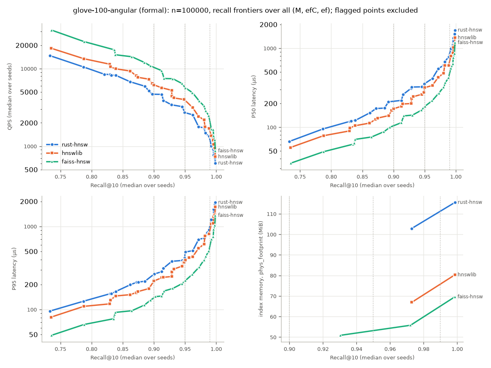
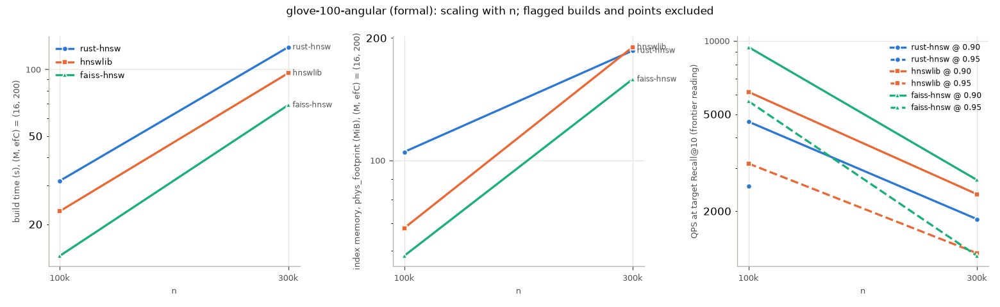
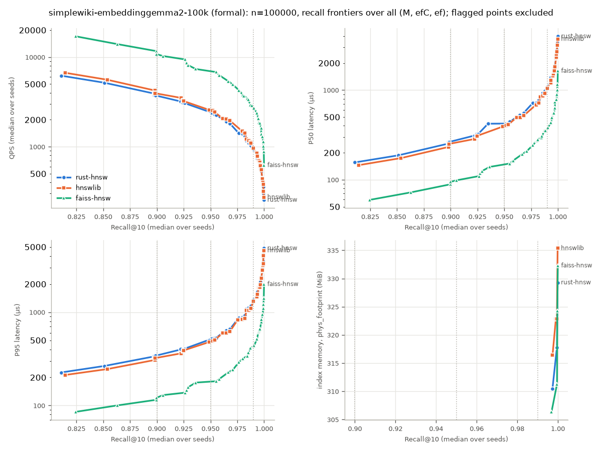
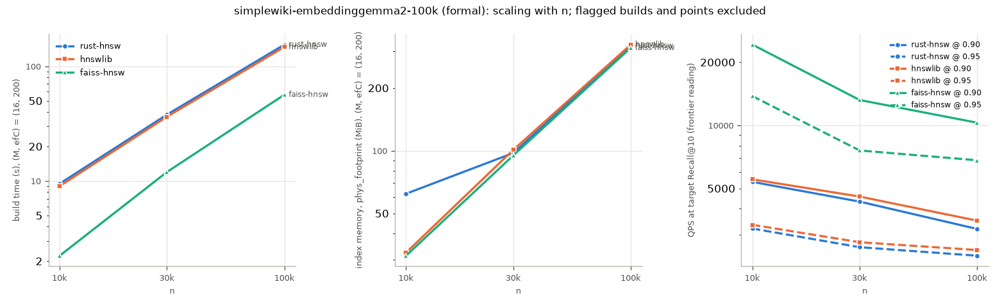

# rust-hnsw

研究問題：哪些演算法與低階實作決策，真正決定 HNSW 的 recall、延遲與記憶體取捨？
完整規格見 [`SPEC.md`](SPEC.md)，目前進度見 [`NEXT.md`](NEXT.md)。

## 目前狀態

- Core / Day 1 完成：cosine distance、exact brute-force（ground truth）、
  Python binding skeleton、固定的 Python batch interface。
- Core / Week 1 進行中：HNSW insert / search、save / load、Python binding 與 efSearch 介面、
  hnswlib / FAISS adapters、benchmark runner（smoke 已驗證）已完成。
- 資料集已登記：`glove-100-angular`（frozen ground truth n = 100k / 300k / 1,183,514）、
  正式文字 workload `simplewiki-embeddinggemma2-100k`（decision 012；n = 10k / 30k / 100k）與文字 pilot。
- **真實資料上的 correctness 已通過**（SPEC Core 3；smoke 模式，計時不作任何結論）：三個實作的 Recall@10 都隨 efSearch 單調上升，
  沒有系統性惡化，也沒有結果不足 k。

  | 資料集 | n | M / efC | Recall@10（ef = 10 → 64 → 256；三者相近） |
  | --- | --- | --- | --- |
  | glove-100-angular | 100,000 | 16 / 200 | 約 0.55 → 0.83 → 0.95 |
  | glove-100-angular | 1,183,514 | 16 / 200 | ef = 64 → 256 → 1024：約 0.76 → 0.88 → 0.955 |
  | 文字 pilot（768 維） | 10,000 | 16 / 200 | 約 0.79 → 0.98 → 0.999 |
  | 文字（768 維，正式資料集） | 100,000 | 16 / 200 | 約 0.77 → 0.97 → 0.996 |

  完整 GloVe 上，ann-benchmarks 自帶的 neighbors 與本專案以 exact search 產生的 ground truth 完全一致。
- 正式 benchmark 進行中：正式格點已事先登記，12 份 formal config 全部 commit（decision 013）；閒置 load 量測為 `ok`。GloVe 的 8 份已完成並產生正式報告，文字 workload 的 4 份還要在 Mac heavy lock 下跑（見 `NEXT.md`）。Gate 的讀法在看任何結果之前登記（decision 015）。兩個資料集的正式結果與 Gate profiling 見下三節；是否進 Advanced 由使用者決定。

## 正式結果：glove-100-angular（標準 ANN 資料集）

條件：Apple M4 Pro（8P + 4E）、48 GB、macOS 27.0.1；協定 008-v2、高效能電力模式、Apple 70W、Mac heavy lock；三個實作都透過同一層
Python batch interface、單執行緒（decision 002、008）。8 份 formal config（decision 013）、21 個 build × 3 個實作，完整報告由
`benchmarks/report.py` 產生（`results/` 不進版控）。所有讀值依事先登記的 decision 010：id-based Recall@10、跨 seed median、
frontier 取點不內插、有 hygiene 標記的點不進入主要讀值。



**n = 100,000 的 frontier 讀值**（每格附上該點的 (M, efC, ef)；QPS 有多個 seed 時附 [min, max]）：

| 目標 Recall@10 | 實作 | QPS | P50 (µs) | P95 (µs) | index memory，phys_footprint (MiB) |
| --- | --- | --- | --- | --- | --- |
| 0.90 | rust-hnsw | 4,656 [4,011, 4,972]（48 / 200 / 64） | 219（48 / 200 / 64） | 266（16 / 400 / 128） | 102.8（16 / 100） |
| 0.90 | hnswlib | 6,168（16 / 400 / 128） | 172（16 / 400 / 128） | 221（16 / 400 / 128） | 66.9（16 / 100） |
| 0.90 | faiss-hnsw | 9,423 [8,787, 9,479]（48 / 200 / 64） | 114（48 / 200 / 64） | 143（16 / 200 / 128） | 50.9（8 / 200） |
| 0.95 | rust-hnsw | 2,537 [2,334, 2,706]（48 / 200 / 128） | 414（48 / 200 / 128） | 491（16 / 400 / 256） | 102.8（16 / 100） |
| 0.95 | hnswlib | 3,135 [3,032, 3,153]（48 / 200 / 128） | 318（16 / 400 / 256） | 394（16 / 400 / 256） | 66.9（16 / 100） |
| 0.95 | faiss-hnsw | 5,650（32 / 200 / 128） | 184（32 / 200 / 128） | 223（32 / 200 / 128） | 55.8（16 / 400） |
| 0.99 | rust-hnsw | 1,008（32 / 200 / 384） | 991（32 / 200 / 384） | 1,213（32 / 200 / 384） | 115.6（32 / 200） |
| 0.99 | hnswlib | 1,363（32 / 200 / 384） | 797（32 / 200 / 384） | 1,064（32 / 200 / 384） | 80.3（32 / 200） |
| 0.99 | faiss-hnsw | 1,654（32 / 200 / 384） | 561（32 / 200 / 384） | 701（32 / 200 / 384） | 69.6（32 / 200） |

- **QPS 比值**（frontier 讀值）：hnswlib ÷ rust-hnsw = 1.32 / 1.24 / 1.35，faiss-hnsw ÷ rust-hnsw = 2.02 / 2.23 / 1.64（0.90 / 0.95 / 0.99）。
- **Gate 的判讀（decision 015，事先登記）**：主要目標 0.95 為「在 ef 梯子的量化範圍內，無法區分」——rust-hnsw 的 QPS 範圍 [2,537, 3,234]、
  hnswlib [3,135, 4,192] 重疊；0.90 為「不確定」（QPS 範圍分開，但交點前後的 seed 範圍沒有分開），0.99 也無法區分。
  依 015，GloVe 上「同 recall 下與 hnswlib 有差距」**不成立**。
- **看到結果之後的觀察（不是事先登記的判讀）**：在 variance 格點上，兩者在**同一個 ef** 達到目標、Recall@10 相同到小數第 3–4 位時，
  5 組比較的 hnswlib seed 範圍都整段高於 rust-hnsw，median 比值 1.22–1.38。015 的規則刻意保守（容許 rust-hnsw 的交點落在更小的 ef），所以沒有判為有差距。
- **recall 隨 efSearch**：三個實作在每個 (n, M, efC) 都沒有系統性惡化；rust-hnsw 與 hnswlib 在相同 (M, efC, ef) 的 recall 幾乎相同。
- **build time 與記憶體**（(16, 200)，5 個 seed 的 median）：build 31.4 / 22.9 / 14.4 s，peak RSS 190 / 158 / 158 MiB，
  index memory 104.9 / 68.1 / 58.2 MiB（rust-hnsw / hnswlib / faiss-hnsw）。rust-hnsw 的 peak RSS 包含 `add` 期間的一份正規化暫時副本（NEXT B1）。



**限制（照實列出）**：

- n = 1,183,514 的三個 build 都因其他專案沒有取 lock 的背景工作被標記 `background`，依 010 §3 沒有主要讀值；圖中的 scaling 只有 100k 與 300k。
- 300k 的 rust-hnsw 在 ef 512 / 768 有 `load` 標記，0.95 在主要讀值中「未達到」（包含標記點時為 915 QPS @ ef 512）。
- M = 8 的 rust-hnsw build（`background`）與 hnswlib 的全部點（`load`）被標記，兩者記憶體讀值的最小點因此落在 (16, 100)。
- 單一 seed 的格點（300k、1,183,514、M8、M32、efC 100 / 400）沒有自己的 seed 範圍；variance 只在 (16, 200) 與 (48, 200)。

## 正式結果：simplewiki-embeddinggemma2-100k（真實文字、768 維）

條件：同一台 Mac；協定 008-v4（decision 016–018：高效能電力模式、Apple 140W、電量只記錄）、Mac heavy lock、單執行緒 batch。
4 份 formal config、17 個 build × 3 個實作；先前因暫停、其他專案的負載、電力模式被改變與協定修訂而失敗或作廢的 7 個 run 都以 `--excluded` 列出（decision 016、017）。
資料：Simple English Wikipedia 的 passage，以 `google/embeddinggemma-2` 產生 document embedding（decision 011、012），base 100,000、query 2,000。



**n = 100,000 的 frontier 讀值**（每格附上該點的 (M, efC, ef)；index memory 附 (M, efC)）：

| 目標 Recall@10 | 實作 | QPS | P50 (µs) | P95 (µs) | index memory，phys_footprint (MiB) |
| --- | --- | --- | --- | --- | --- |
| 0.90 | rust-hnsw | 3,203（16 / 100 / 32） | 311（16 / 100 / 32） | 397（8 / 200 / 64） | 310.4（8 / 200） |
| 0.90 | hnswlib | 3,509（8 / 200 / 64） | 285（8 / 200 / 64） | 362（8 / 200 / 64） | 316.4（8 / 200） |
| 0.90 | faiss-hnsw | 10,290（8 / 200 / 48） | 99（8 / 200 / 48） | 129（8 / 200 / 48） | 306.4（8 / 200） |
| 0.95 | rust-hnsw | 2,387（16 / 100 / 48） | 423（16 / 100 / 48） | 520（16 / 100 / 48） | 310.4（8 / 200） |
| 0.95 | hnswlib | 2,541（16 / 100 / 48） | 400（16 / 100 / 48） | 490（16 / 100 / 48） | 316.4（8 / 200） |
| 0.95 | faiss-hnsw | 6,811（16 / 100 / 48） | 152（16 / 100 / 48） | 182（16 / 100 / 48） | 306.4（8 / 200） |
| 0.99 | rust-hnsw | 934（48 / 200 / 64） | 1,083（48 / 200 / 64） | 1,358（48 / 200 / 64） | 310.4（8 / 200） |
| 0.99 | hnswlib | 844（32 / 200 / 96） | 1,203（32 / 200 / 96） | 1,468（32 / 200 / 96） | 316.4（8 / 200） |
| 0.99 | faiss-hnsw | 2,692 [2,689, 2,699]（16 / 200 / 128） | 380（16 / 200 / 128） | 437（16 / 200 / 128） | 306.4（8 / 200） |

- **QPS 比值**（frontier 讀值，n = 100k）：hnswlib ÷ rust-hnsw = 1.10 / 1.06 / 0.90，faiss-hnsw ÷ rust-hnsw = 3.21 / 2.85 / 2.88（0.90 / 0.95 / 0.99）。
  n = 10k、30k 時 hnswlib ÷ rust-hnsw 為 1.03–1.07，faiss-hnsw ÷ rust-hnsw 為 2.9–4.5。
- **variance 格點 (16, 200)**（5 個 seed；同一個 ef）：hnswlib 對 rust-hnsw 的 QPS median 為 3,276 對 3,103（ef 32）、2,439 對 2,299（ef 48）、799 對 743（ef 192），
  median 相差 6–8%；seed 之間的範圍多半 < 1%（hnswlib 在 ef 48、192 為 6–7%）。
- **Gate 的判讀（decision 015，事先登記）**：0.90 / 0.95 / 0.99 都是「在 ef 梯子的量化範圍內，無法區分」（主要目標 0.95：rust-hnsw [2,387, 3,203]、hnswlib [2,541, 3,401]）。
- **recall 隨 efSearch**：三個實作在每個 (n, M, efC) 都沒有系統性惡化，最大相鄰下降 0。
- **build time 與記憶體**（n = 100k，(16, 200) 的 median）：build 154.7 / 147.7 / 56.6 s，peak RSS 950 / 667 / 668 MiB，
  index memory 318.8 / 323.3 / 312.5 MiB（rust-hnsw / hnswlib / faiss-hnsw；向量本身約 293 MiB）。
  rust-hnsw 的 peak RSS 多出約一份資料，是 `add` 期間的正規化暫時副本（NEXT B1）。



**兩個資料集合起來（依 decision 015）**：兩個資料集的主要目標都不是「有差距」，所以 SPEC Gate 的「同 recall 下與 hnswlib 有差距」**不成立**；
「無法區分」不等於「很接近 hnswlib」，是否適用 SPEC 的特例（Advanced 改聚焦 vector quantization）由使用者判斷。
看到結果之後的描述（不是判讀）：100 維的 GloVe 上 hnswlib 在同 ef、同 recall 時快 1.22–1.38 倍，768 維的文字上只快 6–8%；FAISS 在兩者都最快（GloVe 1.6–2.2 倍、文字 2.9–4.5 倍）。
差距的來源見下一節的 Gate profiling。

## Gate profiling：時間花在哪（decision 009、015 §2）

條件：兩個資料集各取 (n, M, efC) = (100,000, 16, 200)、seed 1，各實作在正式 run 中 Recall@10 ≥ 0.95 的最小 ef
（GloVe：rust-hnsw 304、hnswlib 304、faiss-hnsw 256；文字：三者都是 48）；macOS `sample` 每 1 ms 取樣，search 30 秒、build 300 秒；
heavy lock、formal 的電力與背景條件。12 次取樣都通過 `gate_profile check`：取樣時的 Recall@10 與正式 run **完全相同**，git 乾淨、被取樣的程式與正式 run 相同。
下表是 top-of-stack（self time）的占比；分類是看過取樣之後的解讀，原始排行在 `results/profiles/`。

| 資料集 / 階段 | rust-hnsw | hnswlib | faiss-hnsw（近似，見下） |
| --- | --- | --- | --- |
| GloVe search | `search_layer`（含被 inline 的距離計算）47.9%；visited set（`HashMap` insert + rehash，SipHash）**43.6%**；heap 7.4% | 距離計算 `InnerProductDistance` 55.5%；`searchBaseLayerST`（含陣列式 visited list）42.4% | ≈ `HNSW::search` 87.6%；≈ 距離 11.9% |
| GloVe build | `search_layer` 38.9%；visited set **38.4%**；`add` 12.4%；heap 7.4% | 距離 51.3%；`searchBaseLayer` 38.7%；鄰居選擇 5.2% | ≈ `add_links_starting_from` 68.3%；≈ 距離 20.1% |
| 文字 search | `search_layer` 84.8%；`greedy_search` 7.3%；visited set 6.4% | 距離 92.0%；`searchBaseLayerST` 7.5% | ≈ 距離 81.3%；≈ `HNSW::search` 18.2% |
| 文字 build | `search_layer` 69.3%；`add` 19.5%；visited set 6.8% | 距離 90.9%；`searchBaseLayer` 7.2% | ≈ 距離 78.0%；≈ `add_links_starting_from` 18.5% |

- rust-hnsw 的距離計算被 inline 進 `search_layer`，無法單獨拆出（009 已知限制）；拆開需要另寫 decision（例如 `xctrace` 搭配 debug line info）。
- faiss-cpu 的 `libfaiss.dylib` 沒有符號表，FAISS 的分類以「之前最近的 text 符號」近似（009 補記），只看大類。
- 看到取樣之後的描述（不是事先登記的判讀）：100 維時，rust-hnsw 約四成的時間花在以 `std::collections::HashMap`（SipHash）實作的 visited set，
  hnswlib 用陣列式的 visited list，這部分不在它的排行前段；768 維時距離計算占絕大部分，兩者的 visited set 開銷都變小，與文字資料上兩者 QPS 相近一致。

## 目錄

```text
crates/hnsw/        Rust 實作（distance、exact search、HNSW、save / load）
python/             PyO3 binding，Python module 名稱 `rust_hnsw`
benchmarks/         統一 batch interface、adapters、Recall 指標、benchmark runner（run.py）、報告（report.py）
benchmarks/configs/ runner 的 TOML config（smoke、真實資料的 correctness、成本探測）
benchmarks/manifests/ 資料集的 manifest（來源、checksum、切分、frozen ground truth）
tests/              Python 測試（binding、adapters、第三方原生語意、interface、metrics）
scripts/test.sh     一鍵跑全部 correctness 檢查
scripts/profile.sh  以 macOS `sample` 對 build / search 取樣（decision 009）
docs/decisions/     decision logs
tools/with-mac-lock 正式 benchmark 用的 Mac heavy lock
examples/           API 的 Demo（synthetic 資料，數字不是研究結果）
```

## 開發環境

```bash
# Rust（rustup 安裝時未改 PATH，每個新 shell 需先載入）
source "$HOME/.cargo/env"

# Python 3.13 venv
uv venv --python 3.13 .venv
uv pip install --python .venv/bin/python -r requirements-dev.txt
```

## 快速上手（Python）

`./scripts/test.sh`（或 `maturin develop --release`）會把 binding 安裝到 `.venv`。最小用法：

```python
import numpy as np
import rust_hnsw

data = np.random.default_rng(0).standard_normal((10_000, 64)).astype(np.float32)
data /= np.linalg.norm(data, axis=1, keepdims=True)        # cosine 距離：輸入必須是 unit vectors（decision 001）

index = rust_hnsw.HnswIndex(64, m=16, ef_construction=200, seed=1)
index.add(data)                                             # 依 row 順序插入；id 就是 row 編號
ids, distances = index.search(data[:5], 10, 64)             # (queries, k, ef_search) → int64 / float32，shape (5, 10)
index.save("demo.hnsw")
same = rust_hnsw.HnswIndex.load("demo.hnsw")                # 讀回的 index 給出完全相同的結果
```

- `search` 是一次批次呼叫；結果不足 k 時補 `-1` / `+inf`。距離是 cosine distance（`1 − 內積`，範圍 [0, 2]）。
- `rust_hnsw.ExactIndex(dim)` 是 brute-force 的 exact search，只用來產生 ground truth 與 correctness 檢查。
- 完整的 Demo（建 index、不同 `ef_search` 的 Recall@10、存檔與讀回）：

```bash
.venv/bin/python examples/quickstart.py
```

Demo 用隨機產生的 synthetic 向量，只示範 API，印出的數字**不是研究結果**。

## 測試

```bash
./scripts/test.sh
```

依序跑 rustfmt、clippy、`cargo test`、`maturin develop --release`、pytest。
這些是 correctness 檢查，不需要 Mac heavy lock；正式 benchmark 才需要（見 `MACHINE_POLICY.md`）。

## Benchmark runner（decision 008）

```bash
# smoke：只驗證 runner 本身（synthetic 資料，數字不得用於報告），不需要 lock
.venv/bin/python -m benchmarks.run benchmarks/configs/smoke.toml --mode smoke

# formal：先在乾淨的 HEAD 上跑 ./scripts/test.sh，再在 lock 下執行
./tools/with-mac-lock .venv/bin/python -m benchmarks.run <formal config> --mode formal
```

輸出在 `results/runs/<UTC 時間>-<mode>/`（不進版控）。formal 只接受已登記的真實資料集。

第一次 formal run 之前，先在 lock 下量閒置 load（008 §2；其他 process 有重工作時判為 `not_idle`）：

```bash
./tools/with-mac-lock .venv/bin/python -m benchmarks.idle_load
```

真實資料上的 correctness run（smoke，只看 recall 隨 efSearch 的變化）：

```bash
.venv/bin/python -m benchmarks.run benchmarks/configs/glove-correctness.toml --mode smoke
.venv/bin/python -m benchmarks.run benchmarks/configs/text-pilot-correctness.toml --mode smoke
```

Gate 用的 profiling（009；正式資料集、lock 下，取樣前寫出參數、git、編譯資訊與 Recall@10）：

```bash
./tools/with-mac-lock ./scripts/profile.sh <名稱> 20 -- --impl rust-hnsw --phase search \
    --dataset glove-100-angular --n 100000 --m 16 --ef-construction 200 --seed 1 --ef 128 --k 10
```

## 資料集（decision 011）

資料檔放在 `datasets/`（不進 Git）；每個資料集的來源、checksum、切分與 frozen ground truth 記在 `benchmarks/manifests/<名稱>.json`。

```bash
# 標準 ANN：glove-100-angular（ann-benchmarks，463 MB）
.venv/bin/python -m benchmarks.prepare_glove --download

# 真實文字：Simple English Wikipedia + google/embeddinggemma-2（768 維、fp32、CPU）
uv venv --python 3.13 .venv-embed
uv pip install --python .venv-embed/bin/python -r requirements-embed.txt
.venv/bin/python -m benchmarks.prepare_text --name simplewiki-embeddinggemma2-pilot --n-base 10000 --n-queries 1000
# 正式文字 workload（decision 012）
.venv/bin/python -m benchmarks.prepare_text --name simplewiki-embeddinggemma2-100k --n-base 100000 --n-queries 2000 \
    --gt-n 10000 --gt-n 30000 --gt-n 100000
```

報告（依 decision 010 的比較規則：frontier 讀值、variance、scaling、recall vs efSearch 圖）：

```bash
.venv/bin/python -m benchmarks.report results/runs/<run 目錄> [<run 目錄> ...]
```

正式 run 的批次（decision 013 §5、014；等機器可用時在 heavy lock 下依序執行，任一 run 不是 complete 就停）：

```bash
mkdir -p results/batches
./scripts/formal_launcher.sh results/batches/<名稱>.log <最長等待秒數> --powermode 2 [--skip-idle] benchmarks/configs/<formal config>.toml ...
```

Gate profiling（decision 015：依正式 run 選各實作 Recall@10 ≥ 0.95 的最小 ef，在 heavy lock 下取樣，取樣後核對證據條件；
計畫寫在 `results/` 下，不讓 repo 變 dirty）：

```bash
.venv/bin/python -m benchmarks.gate_profile plan <該資料集全部 formal run 目錄> > results/profiles/gate-<資料集>-plan.sh
./tools/with-mac-lock bash results/profiles/gate-<資料集>-plan.sh
.venv/bin/python -m benchmarks.gate_profile check <同一組 run 目錄>
```

## 主要決策

- [001 cosine 距離定義、正規化與 tie-break](docs/decisions/001-cosine-distance-and-normalization.md)
- [002 統一 Python batch interface 與計時協定](docs/decisions/002-python-batch-interface.md)
- [003 Recall@K 定義與 tie-aware 診斷](docs/decisions/003-recall-definition.md)
- [004 HNSW Core 演算法細節與 baseline 表示法](docs/decisions/004-hnsw-core-algorithm.md)
- [005 HNSW index 檔案格式（save / load）](docs/decisions/005-index-file-format.md)
- [006 HNSW 的 Python binding 與 efSearch 介面](docs/decisions/006-hnsw-python-binding.md)
- [007 hnswlib / FAISS adapters 與實測語意](docs/decisions/007-third-party-adapters.md)
- [008 benchmark runner 與量測協定的落實](docs/decisions/008-benchmark-runner.md)
- [009 profiling 方法（Gate 證據的產生方式）](docs/decisions/009-profiling-method.md)
- [010 比較規則與 variance 彙整（事先登記）](docs/decisions/010-comparison-rules.md)
- [011 資料集：glove-100-angular 與 EmbeddingGemma 2 文字 workload](docs/decisions/011-datasets.md)
- [012 正式文字 workload 的規模](docs/decisions/012-text-workload-scale.md)
- [013 正式 run 的格點（formal config）](docs/decisions/013-formal-grid.md)
- [014 正式 run 的電力條件、背景 workload 與 index memory 指標](docs/decisions/014-formal-run-conditions-and-index-memory.md)
- [015 Gate 證據的讀法與 Gate profiling 的參數（事先登記）](docs/decisions/015-gate-evidence.md)
- [016 文字 workload 的電力模式不一致：作廢 text-formal-2、3，全部以高效能模式重跑](docs/decisions/016-text-power-mode-voided-runs.md)
- [017 取消電量下降的作廢規則（協定 008-v3）](docs/decisions/017-remove-battery-drop-rule.md)
- [018 允許 Apple 原廠 140W 變壓器（協定 008-v4）](docs/decisions/018-allow-140w-adapter.md)
- [019 Advanced C：vector quantization 的假設、表示與評測協定（事先登記）](docs/decisions/019-advanced-c-vector-quantization.md)
