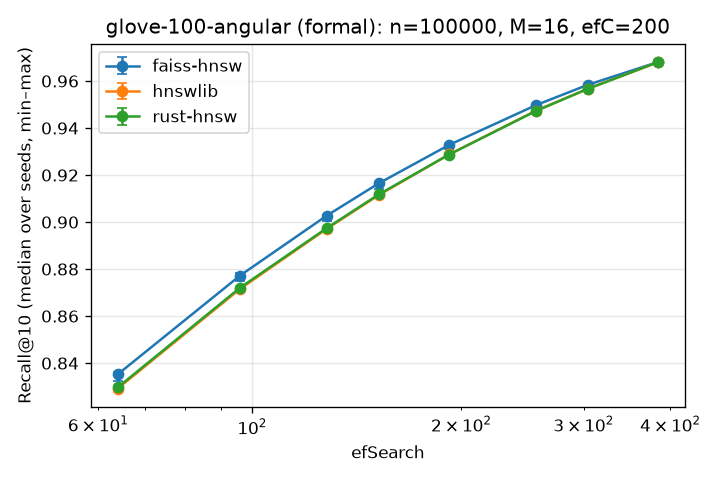
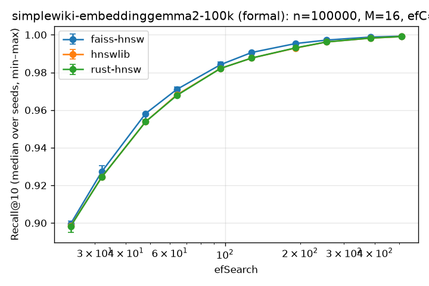
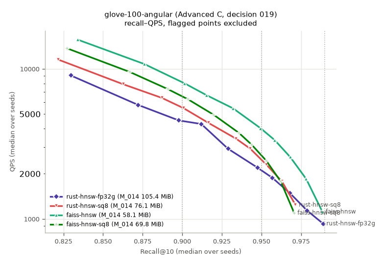
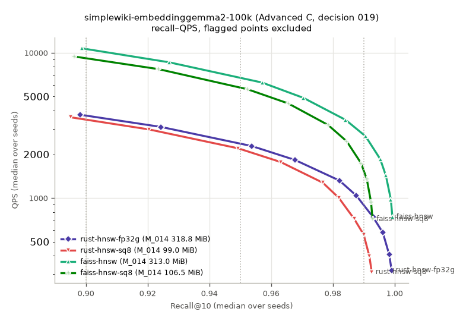
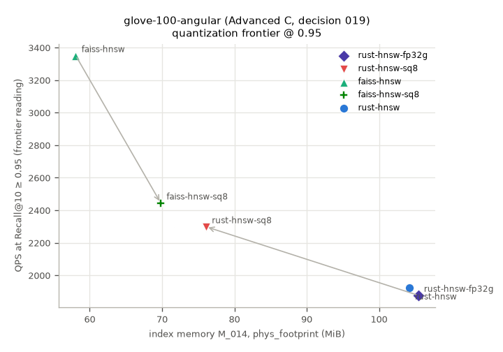
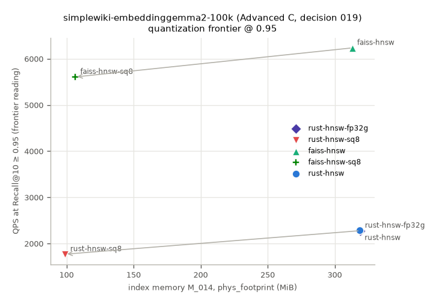
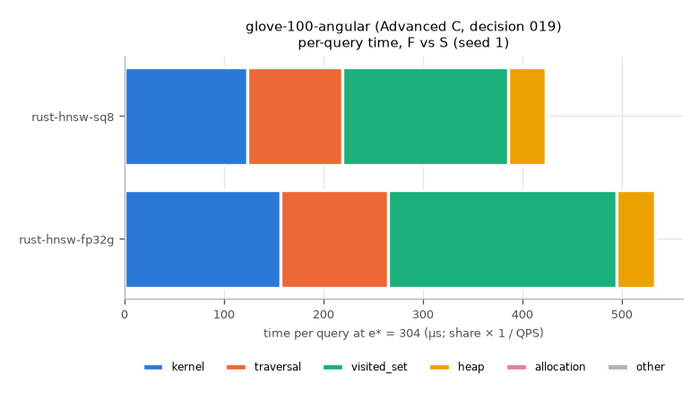
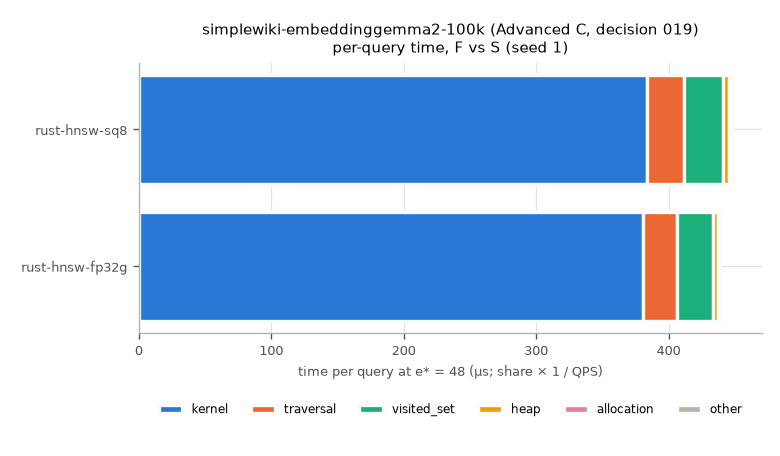
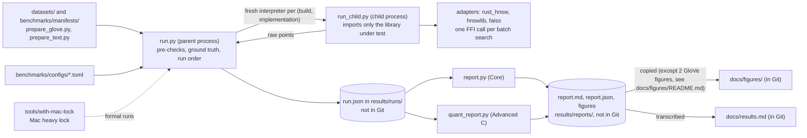

# rust-hnsw

[](LICENSE)


**English** | [繁體中文](README.zh-TW.md)

**Which algorithmic and low-level implementation decisions actually determine HNSW's trade-off between recall,
latency and memory?**
This project implements HNSW from scratch in Rust and measures it against hnswlib and FAISS through one Python batch
interface, under comparison rules that were registered before the results were seen.
Full specification: [`SPEC.md`](SPEC.md). Development log: [`NEXT.md`](NEXT.md).

> The decision logs and the detailed documents are written in Traditional Chinese (see
> [Documentation map](#documentation-map)). This README is the English entry point; [README.zh-TW.md](README.zh-TW.md)
> is the Traditional Chinese version with the same numbers and verdicts.

## At a glance

- **Problem.** When HNSW is implemented from scratch, which algorithmic and low-level implementation decisions decide
  the trade-off between recall, latency and memory? Where, and by how much, does such an implementation differ from
  the mature hnswlib and FAISS?
- **Approach.**
  - HNSW written from scratch in Rust (cosine; insert, search, save / load). The `hnsw` crate has no external
    dependencies; a PyO3 binding exposes it to Python.
  - rust-hnsw, hnswlib 0.8.0 and FAISS HNSW (faiss-cpu 1.15.1) are measured through the same Python batch interface,
    single-threaded; every build is measured in a fresh child process (see
    [Fairness and methodology](#fairness-and-methodology)).
  - Data: the standard ANN dataset glove-100-angular (100-d) and real text embeddings (Simple English Wikipedia +
    `google/embeddinggemma-2`, 768-d).
  - The comparison rules, the reading of the Gate and the Advanced C hypotheses were registered before the
    corresponding results were seen (decisions 010, 015, 019; timeline in [Research discipline](#research-discipline)).
- **Headline results** (frontier readings at n = 100,000 for the target Recall@10 ≥ 0.95; each section names the source
  report of its numbers; terms are defined in the [Glossary](#glossary)):
  - QPS: rust-hnsw 2,537, hnswlib 3,135, faiss-hnsw 5,650 on GloVe; 2,387, 2,541, 6,811 on text.
  - Gate condition 3, "a gap to hnswlib at the same recall", **does not hold** under the pre-registered decision 015:
    on both datasets the primary target is `within_quantization` (indistinguishable at the resolution of the efSearch
    ladder; unrelated to vector quantization).
    Post-hoc observation (not a reading): at the same ef and the same recall, hnswlib is 1.22–1.38× faster on GloVe
    and only 6–8% faster on text.
  - Gate profiling (an observation, not validated by an intervention): at 100-d, 43.6% of rust-hnsw's search self time
    is in the visited set, a `std::collections::HashSet` with the default SipHash hasher; at 768-d, distance computation
    dominates.
  - **Advanced C (SQ8 vector quantization)**: entered by the owner's decision under a special case in the SPEC; this
    **does not mean the Gate passed**.
    H1a holds, H1b is undetermined, **H1 overall is undetermined**; **H2 holds** (SQ8's recall loss comes mainly from
    the final ranking, not from traversal).
    The primary memory metric M_014 goes from 318.8 → 99.0 MiB on text and 105.4 → 76.1 MiB on GloVe; under the
    pre-registered reading, the speed trade-off is `uncertain` or `within_quantization` (see
    [Advanced C](#advanced-c-vector-quantization-decision-019)).
- **What is and is not validated.**
  - One Apple M4 Pro (macOS 27.0.1), single-threaded, mainly n = 100,000. The measurements use macOS-specific system
    interfaces and were not run on any other platform.
  - In GloVe's Advanced C runs, 3 seeds (1, 4, 5) are flagged for background load, so H1b is undetermined; the GloVe
    n = 1,183,514 grid point has no main reading.
  - Advanced A, B and every Optional item (SIMD, parallel build, x86, …) were not done; see
    [Not done and future work](#not-done-and-future-work).
  - The formal reports and raw runs are not in Git; their key tables are transcribed value for value in
    [`docs/results.md`](docs/results.md).
- **Status (2026-10-19).** Core and Advanced C are complete, and Advanced is sealed.

## Glossary

| Term | Meaning | Source |
| --- | --- | --- |
| Core | The required stage of the SPEC: HNSW from scratch in Rust (insert, search, save / load; cosine), the Python binding, hnswlib / FAISS HNSW as baselines, and formal benchmarks on a standard ANN dataset and a real text-embedding dataset | SPEC "Core" |
| Gate | The four SPEC conditions for moving from Core to Advanced: (1) correctness passes; (2) recall improves or saturates with efSearch, without systematic degradation; (3) a gap to hnswlib at the same recall; (4) the profiler shows where the time goes. Read under 015; condition 3 does not hold (see [Gate summary](#gate-summary)) | SPEC "Gate", 015 §1 |
| SPEC special case | "If Core is already close to hnswlib, there is no need to force an optimization attribution; Advanced instead focuses on the vector quantization frontier" (translated). Entering Advanced C under it was the owner's decision; it does not mean the Gate passed | SPEC "Gate" (special case) |
| Advanced C | Advanced experiment C of the SPEC, vector quantization: FP32 against an 8-bit scalar-quantized representation (SQ8), for memory, recall and latency. The only Advanced experiment done | SPEC "Advanced", 019 |
| frontier reading | For each implementation and target Recall@10 (0.90 / 0.95 / 0.99): among all measured (M, efC, ef) points whose cross-seed median Recall@10 is ≥ the target, the point with the highest QPS (P50, P95 and memory each take their own best point). Neither interpolated nor extrapolated; "not reached" when no point qualifies | 010 §2 |
| R / F / S / P / Q | Advanced C's comparison arms. R = `rust-hnsw` (Core, anchor), F = `rust-hnsw-fp32g` (FP32 on a copied search path), S = `rust-hnsw-sq8` (SQ8 on the same graph and path as F), P = `faiss-hnsw` (FAISS FP32), Q = `faiss-hnsw-sq8` (P's graph transplanted into `IndexHNSWSQ`); table in [Advanced C](#advanced-c-vector-quantization-decision-019) | 019 §2, §3 |
| H1 | Advanced C's latency hypothesis. rust-hnsw's distance kernel sums along a sequential f32 dependency chain of length d; SQ8 cuts each component from 4 bytes to 1 but does not shorten the chain. So at 768-d (text) the cost per distance evaluation should not change (**H1a**: every clean pair's ρ_eval in [0.90, 1.10]), and at 100-d (GloVe), where the chain is short, it should drop (**H1b**: every clean pair's ρ_eval ≥ 1.05). **H1c** contrasts the two dimensions, and **H1d** checks the kernel time with the profiler (κ, seed 1); H1a–H1c each need at least 3 clean pairs. The premise (both kernels sum in one sequential scalar chain) is checked by disassembly first | 019 §2 |
| H2 | Advanced C's recall hypothesis: on the same graph, SQ8's Recall@10 loss comes mainly from the final ranking (the representation's distance error pushes true neighbors among the candidates out of the top 10), not from traversal (SQ8 distances changing which points enter the ef candidates) | 019 §2 |
| `within_quantization` | The two QPS brackets overlap: the implementations cannot be distinguished within the **quantization of the ef ladder**. "Quantization" here means that ef was measured at only a few discrete values; it is **unrelated to Advanced C's vector quantization (SQ8)** and does not mean "close to hnswlib" | 015 §1 |
| `uncertain` | The QPS brackets are separate, but the seed ranges at some pre-attached variance grid point are not (or data are missing, the upper bound is unknown, or there are too few unflagged builds) | 015 §1 |
| `gap` / `rust_faster` | The QPS brackets are separate with hnswlib faster (`rust_faster`: the reverse), and the seed ranges are separate at every attached variance grid point. Advanced C's counterparts are `sq8_faster` / `fp32_faster` | 015 §1, 019 §6 |
| `undetermined` | One side did not reach the target | 015 §1 |
| QPS bracket | The lower bound is the frontier reading; the upper bound is the QPS at the ef **just before** the first ef that reaches the target, maximized over (M, efC) grid points. It handles a true crossing that falls between two measured ef values | 015 §1 |
| hygiene flags | Flagged points are reported as usual but kept out of the main readings. `load`: the 1-minute load average exceeded 4.0 at the point or at the end of the build. `background`: while the child process ran, another process averaged ≥ 50% CPU under one pid over the whole child, processes with the same command summed to ≥ 100%, or one pid was ≥ 50% for 4 consecutive intervals; the flag only says that load not belonging to this run was present, not what that load was. Others: `thermal`, `memory` (too much memory compressed during the build), `swap`, `power` (not on AC), `multithread`, `nondeterministic` | 008 §9, 014 and addenda |
| e\* | The fixed ef used for the Advanced C verdicts: the first ef at which rust-hnsw's cross-seed median Recall@10 is ≥ 0.95 at (100k, 16, 200) in the Core formal report. GloVe 304, text 48 | 019 §2 |
| ρ_eval | ρ_QPS × D_S / D_F, the ratio of distance evaluations completed per second, S to F. ρ_QPS = QPS_S / QPS_F; D is the mean number of distance-kernel calls per query (from an untimed diagnostic) | 019 §2 |
| κ | The kernel time-per-evaluation ratio t_k(S) / t_k(F), with t_k(X) = f_k(X) / (QPS_X · D_X) and f_k the kernel category's share of self time. Taken only from seed 1's profiling, for H1d | 019 §2, §8 |
| ν | The time-per-evaluation ratio of non-kernel work. Diagnostic only, never used for a verdict | 019 §2 |
| L_total / L_trav / L_rank | L_total = R_F − R_S (total loss), L_trav = T_F − T_S (caused by traversal), L_rank = T_S − R_S (caused by ranking). R is the formal Recall@10; T is the Recall@10 after re-ranking the ef candidates by exact distance. In the H2 verdict table, "holds" requires L_trav ≤ 0.25 × L_total + 0.001 for every valid seed (after first ruling out cases such as too few valid seeds) | 019 §2 |
| M_014 / M_relief | M_014: the primary index-memory metric, the increase of phys_footprint from before to after the build (decision 014). M_relief: the increase after the child calls `malloc_zone_pressure_relief` at the end; diagnostic only | 014, 019 §6 |
| clean pair | F and S at the same seed and the same ef, where neither child process, nor build, nor point carries a hygiene flag. H1's timing readings use only clean pairs, and H1a–H1c need at least 3 per dataset | 019 §2 |
| protocols 008-v1–v5 | v1: the original runner (smoke runs only). v2 (014): formal power conditions, the battery-drop voiding rule, the background-workload gate and the `background` flag, phys_footprint as the main index memory; GloVe's Core formal runs. v3 (017): removes the battery-drop voiding rule; no run was executed under v3 (018). v4 (018): allows the Apple 140W adapter (never mixed within one report); text's Core formal runs. v5 (019): Advanced C only; adds implementation names and the final relief diagnostic in the child, with the timing constants, gates, flags and power conditions of v4. The report refuses to merge runs of different protocol versions | 008 addendum, 014, 017, 018, 019 |

## Key results

| Stage | Formal evaluation data | Main result | Read together with |
| --- | --- | --- | --- |
| **Core: glove-100-angular** (d = 100) | 8 formal configs, 21 builds × 3 implementations; main n = 100,000 | At Recall@10 0.95: QPS 2,537 / 3,135 / 5,650 (rust-hnsw / hnswlib / faiss-hnsw); hnswlib ÷ rust-hnsw = 1.24 | The pre-registered Gate reading at 0.95 is `within_quantization`, which does **not** mean "close to hnswlib"; FAISS is a NEON wheel and rust-hnsw a scalar loop; n = 1,183,514 has no main reading |
| **Core: simplewiki-embeddinggemma2-100k** (d = 768) | 4 formal configs, 17 builds × 3 implementations; main n = 100,000 | At 0.95: QPS 2,387 / 2,541 / 6,811; hnswlib ÷ rust-hnsw = 1.06 | All three targets are `within_quantization`; 7 failed or voided runs are listed with `--excluded` |
| **Gate** (the four SPEC conditions) | Both Core reports and 12 profiling samples | Conditions 1, 2 and 4 hold; condition 3 **does not hold** | Entering Advanced C was the owner's decision under the SPEC special case; it does **not** mean the Gate passed |
| **Advanced C** (SQ8) | 10 formal configs; n = 100,000, (M, efC) = (16, 200); F and S seeds 1–5, P and Q seeds 1–3 | H1a holds, H1b undetermined, **H1 overall undetermined**; **H2 holds**; M_014 318.8 → 99.0 MiB (text), 105.4 → 76.1 MiB (GloVe) | GloVe seeds 1, 4, 5 are flagged `background`, leaving only 2 clean pairs at e\*; C1 is inconsistent for GloVe F − S (seed 5); the speed readings are `uncertain` / `within_quantization`, not a verdict that SQ8 is faster or slower |

- Every section names the formal report its numbers come from. The reports exist only on the owner's machine and are
  not in Git; [`docs/results.md`](docs/results.md) transcribes their key tables value for value. Some values on this
  page are rounded for readability.
- [`tests/test_readme_claims.py`](tests/test_readme_claims.py) checks the numbers and verdicts of this README and of
  README.zh-TW.md against docs/results.md, and checks the relative links of the public documents.
  [`tests/test_results_doc.py`](tests/test_results_doc.py) checks docs/results.md against the reports when they are
  present locally.

## Core results

### Correctness on real data

SPEC Core 3. Smoke-mode runs on real data confirm that every implementation's Recall@10 rises monotonically with
efSearch, with no systematic degradation and no result shorter than k. Smoke timings support no conclusion.
Source: the smoke runs and their reports in the local `results/runs/` (not in Git). NEXT.md records the run IDs for
GloVe 100k and the text pilot; the GloVe 1,183,514 smoke run (`20261008T154054Z-smoke`) is in decision 013's table,
and the text 100k smoke run (`text-correctness.toml`, `20261008T183825Z-smoke`) in the addenda of 013 (run ID) and
012 (recall).

| Dataset | n | M / efC | Recall@10 (ef = 10 → 64 → 256; the three are close) |
| --- | --- | --- | --- |
| glove-100-angular | 100,000 | 16 / 200 | about 0.55 → 0.83 → 0.95 |
| glove-100-angular | 1,183,514 | 16 / 200 | ef = 64 → 256 → 1024: about 0.76 → 0.88 → 0.955 |
| text pilot (768-d) | 10,000 | 16 / 200 | about 0.79 → 0.98 → 0.999 |
| text (768-d, formal dataset) | 100,000 | 16 / 200 | about 0.77 → 0.97 → 0.996 |

On the full GloVe set, the neighbors that ship with ann-benchmarks agree exactly with the ground truth this project
computes by exact search.

The two figures below come from **formal runs** (not from the smoke runs in the table): Recall@10 against efSearch at
(n, M, efC) = (100,000, 16, 200); each ef shows the cross-seed median, with min–max error bars. They are produced by
`benchmarks/report.py` from the local formal runs (provenance: [`docs/figures/README.md`](docs/figures/README.md)).
The report tables are authoritative; the figures show the shape only.




### glove-100-angular (standard ANN dataset, d = 100)

Conditions: Apple M4 Pro (8P + 4E), 48 GB, macOS 27.0.1; protocol 008-v2, high-power energy mode, Apple 70W
adapter, Mac heavy lock; all three implementations go through the same Python batch interface, single-threaded
(decisions 002, 008). 8 formal configs (decision 013), 21 builds × 3 implementations; the full report is produced by
`benchmarks/report.py` (`results/` is not in Git). Every reading follows the pre-registered decision 010: id-based
Recall@10, cross-seed median, frontier points taken without interpolation, and points with hygiene flags kept out of
the main readings.

Source of the numbers: the local `results/reports/glove-100-angular/report.md` (not in Git); its SHA-256 and the
transcription of the key tables are in [`docs/results.md`](docs/results.md) §1 and §3.


**Frontier readings at n = 100,000** (each cell gives the point's (M / efC / ef); QPS from several seeds shows
[min, max]):

| Target Recall@10 | Implementation | QPS | P50 (µs) | P95 (µs) | index memory, phys_footprint (MiB) |
| --- | --- | --- | --- | --- | --- |
| 0.90 | rust-hnsw | 4,656 [4,011, 4,972] (48 / 200 / 64) | 219 (48 / 200 / 64) | 266 (16 / 400 / 128) | 102.8 (16 / 100) |
| 0.90 | hnswlib | 6,168 (16 / 400 / 128) | 172 (16 / 400 / 128) | 221 (16 / 400 / 128) | 66.9 (16 / 100) |
| 0.90 | faiss-hnsw | 9,423 [8,787, 9,479] (48 / 200 / 64) | 114 (48 / 200 / 64) | 143 (16 / 200 / 128) | 50.9 (8 / 200) |
| 0.95 | rust-hnsw | 2,537 [2,334, 2,706] (48 / 200 / 128) | 414 (48 / 200 / 128) | 491 (16 / 400 / 256) | 102.8 (16 / 100) |
| 0.95 | hnswlib | 3,135 [3,032, 3,153] (48 / 200 / 128) | 318 (16 / 400 / 256) | 394 (16 / 400 / 256) | 66.9 (16 / 100) |
| 0.95 | faiss-hnsw | 5,650 (32 / 200 / 128) | 184 (32 / 200 / 128) | 223 (32 / 200 / 128) | 55.8 (16 / 400) |
| 0.99 | rust-hnsw | 1,008 (32 / 200 / 384) | 991 (32 / 200 / 384) | 1,213 (32 / 200 / 384) | 115.6 (32 / 200) |
| 0.99 | hnswlib | 1,363 (32 / 200 / 384) | 797 (32 / 200 / 384) | 1,064 (32 / 200 / 384) | 80.3 (32 / 200) |
| 0.99 | faiss-hnsw | 1,654 (32 / 200 / 384) | 561 (32 / 200 / 384) | 701 (32 / 200 / 384) | 69.6 (32 / 200) |

- **QPS ratios** (frontier readings): hnswlib ÷ rust-hnsw = 1.32 / 1.24 / 1.35, faiss-hnsw ÷ rust-hnsw =
  2.02 / 2.23 / 1.64 (0.90 / 0.95 / 0.99).
  When reading FAISS's factor, also read the SIMD and compiler-flag facts in
  [Fairness and methodology](#fairness-and-methodology): FAISS is a NEON wheel, rust-hnsw is a scalar loop.
- **Gate reading (decision 015, pre-registered)**: the primary target 0.95 is `within_quantization`, that is,
  "indistinguishable within the quantization of the ef ladder": rust-hnsw's QPS bracket [2,537, 3,234] and hnswlib's
  [3,135, 4,192] overlap. 0.90 is `uncertain` (the QPS brackets are separate, but the seed ranges around the crossing
  are not), and 0.99 is also `within_quantization`.
  Under 015, "a gap to hnswlib at the same recall" **does not hold** on GloVe.
- **Post-hoc observation (not a pre-registered reading)**: on the variance grid points, when both reach the target at
  the **same ef** with Recall@10 equal to the 3rd–4th decimal, hnswlib's seed range lies entirely above rust-hnsw's in
  all 5 comparisons, with median ratios of 1.22–1.38. The 015 rule is deliberately conservative (it allows rust-hnsw's
  crossing to fall at a smaller ef), so it did not read this as a gap.
- **Recall against efSearch**: no implementation degrades systematically at any (n, M, efC); rust-hnsw and hnswlib
  have almost identical recall at the same (M, efC, ef).
- **Build time and memory** ((16, 200), median of 5 seeds): build 31.4 / 22.9 / 14.4 s, peak RSS
  189.6 / 157.7 / 157.7 MiB, index memory 104.9 / 68.1 / 58.2 MiB (rust-hnsw / hnswlib / faiss-hnsw).
  - The three implementations do not build equivalent graphs (decision 007), so build time is **descriptive only** and
    cannot be compared directly.
  - rust-hnsw's peak RSS includes a temporary normalized copy made during `add` (B1 in
    [decision 014](docs/decisions/014-formal-run-conditions-and-index-memory.md)).


**Limitations (stated as they are)**:

- All three builds at n = 1,183,514 were flagged `background` because of other work that did not take the lock (work
  that did not belong to this run), so under 010 §3 this grid point has no main reading; the scaling figure therefore
  shows only 100k and 300k.
  A complete run may not be re-run (010 §3), and the owner decided not to add runs, so this grid point only has
  "readings including flagged points" ([`docs/results.md`](docs/results.md) §3.9).
- At 300k, rust-hnsw has `load` flags at ef 512 / 768, so 0.95 is "not reached" in the main reading (915 QPS @ ef 512
  when flagged points are included).
- The M = 8 rust-hnsw build (`background`) and all of hnswlib's M = 8 points (`load`) are flagged, so both
  implementations' minimum memory readings fall at (16, 100). Including flagged points, the minimum index memory at
  0.90 and 0.95 is 94.0 MiB (rust-hnsw) and 63.2 MiB (hnswlib), both at (8, 200); this is the only column of the
  frontier table that changes ([`docs/results.md`](docs/results.md) §3.1).
- Single-seed grid points (300k, 1,183,514, M8, M32, efC 100 / 400) have no seed ranges of their own; variance exists
  only at (16, 200) and (48, 200).

### simplewiki-embeddinggemma2-100k (real text, d = 768)

Conditions: the same Mac; protocol 008-v4 (decisions 016–018: high-power energy mode, Apple 140W adapter, battery
level recorded only), Mac heavy lock, single-threaded batch. 4 formal configs, 17 builds × 3 implementations; the 7
runs that had failed or been voided earlier (because of a pause, load from other work, the battery-drop rule of that
time, a power mode changed from outside the project, and protocol revisions) are all listed with `--excluded`
(decisions 016, 017; [`docs/results.md`](docs/results.md) §4.10).
Data: Simple English Wikipedia passages, embedded as documents with `google/embeddinggemma-2` (decisions 011, 012);
100,000 base vectors and 2,000 queries.

Source of the numbers: the local `results/reports/simplewiki-embeddinggemma2-100k/report.md` (not in Git);
transcription in [`docs/results.md`](docs/results.md) §4.


**Frontier readings at n = 100,000** (each cell gives the point's (M / efC / ef); index memory gives (M / efC)):

| Target Recall@10 | Implementation | QPS | P50 (µs) | P95 (µs) | index memory, phys_footprint (MiB) |
| --- | --- | --- | --- | --- | --- |
| 0.90 | rust-hnsw | 3,203 (16 / 100 / 32) | 311 (16 / 100 / 32) | 397 (8 / 200 / 64) | 310.4 (8 / 200) |
| 0.90 | hnswlib | 3,509 (8 / 200 / 64) | 285 (8 / 200 / 64) | 362 (8 / 200 / 64) | 316.4 (8 / 200) |
| 0.90 | faiss-hnsw | 10,290 (8 / 200 / 48) | 99 (8 / 200 / 48) | 129 (8 / 200 / 48) | 306.4 (8 / 200) |
| 0.95 | rust-hnsw | 2,387 (16 / 100 / 48) | 423 (16 / 100 / 48) | 520 (16 / 100 / 48) | 310.4 (8 / 200) |
| 0.95 | hnswlib | 2,541 (16 / 100 / 48) | 400 (16 / 100 / 48) | 490 (16 / 100 / 48) | 316.4 (8 / 200) |
| 0.95 | faiss-hnsw | 6,811 (16 / 100 / 48) | 152 (16 / 100 / 48) | 182 (16 / 100 / 48) | 306.4 (8 / 200) |
| 0.99 | rust-hnsw | 934 (48 / 200 / 64) | 1,083 (48 / 200 / 64) | 1,358 (48 / 200 / 64) | 310.4 (8 / 200) |
| 0.99 | hnswlib | 844 (32 / 200 / 96) | 1,203 (32 / 200 / 96) | 1,468 (32 / 200 / 96) | 316.4 (8 / 200) |
| 0.99 | faiss-hnsw | 2,692 [2,689, 2,699] (16 / 200 / 128) | 380 (16 / 200 / 128) | 437 (16 / 200 / 128) | 306.4 (8 / 200) |

- **QPS ratios** (frontier readings, n = 100k): hnswlib ÷ rust-hnsw = 1.10 / 1.06 / 0.90, faiss-hnsw ÷ rust-hnsw =
  3.21 / 2.85 / 2.88 (0.90 / 0.95 / 0.99).
  At n = 10k and 30k, hnswlib ÷ rust-hnsw is 1.03–1.07 and faiss-hnsw ÷ rust-hnsw is 2.89–4.52.
- **Variance grid point (16, 200)** (hnswlib 5 builds; rust-hnsw 4: seed 1's build is flagged `background` and kept
  out of the main reading; same ef): hnswlib against rust-hnsw median QPS is 3,276 vs 3,103 (ef 32), 2,439 vs 2,299
  (ef 48) and 799 vs 743 (ef 192), so the medians differ by 6–8%; seed-to-seed ranges are mostly < 1% (hnswlib: 6–7% at
  ef 48 and 192).
- **Flagged builds**: at (16, 200), the seed 1 builds (original order) of rust-hnsw and faiss-hnsw were flagged
  `background` ([`docs/results.md`](docs/results.md) §4.9), so these two implementations' medians at that grid point
  come from 4 builds. The flag only records that load not belonging to this run was present. Including flagged builds,
  the Gate readings are the same (§4.4), and the only frontier reading that changes is faiss-hnsw's at 0.99:
  2,690 [2,458, 2,699] (5 builds) instead of 2,692 [2,689, 2,699] (4 builds) (§4.1).
- **Gate reading (decision 015, pre-registered)**: 0.90 / 0.95 / 0.99 are all `within_quantization`, that is,
  "indistinguishable within the quantization of the ef ladder" (primary target 0.95: rust-hnsw [2,387, 3,203],
  hnswlib [2,541, 3,401]).
- **Recall against efSearch**: no implementation degrades systematically at any (n, M, efC); the maximum adjacent drop
  is 0.
- **Build time and memory** (n = 100k, median at (16, 200); rust-hnsw and faiss-hnsw 4 builds, hnswlib 5): build
  154.7 / 147.7 / 56.6 s, peak RSS 950.5 / 667.4 / 668.4 MiB, index memory 318.8 / 323.3 / 312.5 MiB (rust-hnsw /
  hnswlib / faiss-hnsw; the vectors themselves take about 293 MiB).
  - The three implementations do not build equivalent graphs (decision 007), so build time is **descriptive only** and
    cannot be compared directly.
  - rust-hnsw's peak RSS is higher by about one copy of the data: the temporary normalized copy made during `add` (B1
    in [decision 014](docs/decisions/014-formal-run-conditions-and-index-memory.md)).


### Both datasets together (decision 015)

Neither dataset's primary target is `gap`, so the SPEC Gate condition "a gap to hnswlib at the same recall" **does not
hold**. "Indistinguishable" is not the same as "close to hnswlib"; whether the SPEC special case applies (Advanced
then focuses on the vector quantization frontier) was left to the owner's judgement (see [Gate summary](#gate-summary)).
Post-hoc description (not a reading): at the same ef and the same recall, hnswlib is 1.22–1.38× faster on 100-d GloVe
and only 6–8% faster on 768-d text; FAISS is the fastest on both (faiss-hnsw ÷ rust-hnsw frontier-reading ratios at
n = 100,000: 1.64–2.23× on GloVe, 2.85–3.21× on text).
Where the time goes is shown under [Gate profiling](#gate-profiling-where-the-time-goes-decisions-009-015-2). That is
an observational attribution; no intervention tested the causes of these differences.

### Gate summary

The SPEC sets four conditions for entering Advanced. The reading follows the pre-registered decision 015 §1. Sources:
the four Gate conditions recorded in NEXT.md and the Gate reading section of both Core reports
(`results/reports/glove-100-angular/report.md`, `results/reports/simplewiki-embeddinggemma2-100k/report.md`; local, not
in Git; transcribed in [`docs/results.md`](docs/results.md) §5).

| Condition (SPEC) | Reading | Basis |
| --- | --- | --- |
| 1. Correctness passes | holds | `./scripts/test.sh` passes in full (including small hand-verifiable cases, decision 004); correctness on real data passes |
| 2. Recall improves or saturates with efSearch, without systematic degradation | holds | No systematic degradation on either dataset at any (n, M, efC) (the report's 010 §6 check; maximum adjacent drop 0) |
| 3. A gap to hnswlib at the same recall | **does not hold** | GloVe's primary target 0.95 is `within_quantization` (0.90 `uncertain`, 0.99 `within_quantization`); all three text targets are `within_quantization`. Under 015, no dataset has `gap` at its primary target, so the condition does not hold |
| 4. The profiler shows where the time goes | holds | All 12 samples pass `gate_profile check` (see [Gate profiling](#gate-profiling-where-the-time-goes-decisions-009-015-2)) |

- `within_quantization` and `uncertain` do **not** mean "close to hnswlib" (015 §1); see the [Glossary](#glossary).
- The SPEC special case says (translated): "if Core is already close to hnswlib, there is no need to force an
  optimization attribution; Advanced instead focuses on the vector quantization frontier". Under 015, whether it
  applies is for the owner to judge.
- **Entering Advanced C was the owner's decision on 2026-10-16 under this special case.** It is not a reading of 015
  and **does not mean the Gate passed**. Core's formal results, the Gate reading and the pre-registered comparison
  rules were not changed by it.

### Gate profiling: where the time goes (decisions 009, 015 §2)

Conditions: on each dataset, (n, M, efC) = (100,000, 16, 200), seed 1, and for each implementation the smallest ef
that reaches Recall@10 ≥ 0.95 in the formal runs (GloVe: rust-hnsw 304, hnswlib 304, faiss-hnsw 256; text: 48 for all
three); macOS `sample` every 1 ms, 30 seconds for search and 300 seconds for build; heavy lock, with the formal power
and background conditions. All 12 samples pass `gate_profile check`: the Recall@10 during sampling is **identical** to
the formal run, Git is clean, and the profiled code is the same as in the formal run.
The table gives top-of-stack (self time) shares; the categories are an interpretation made after looking at the
samples. The raw rankings are in the local `results/profiles/` (`gate-*.top.txt`, not in Git).

This is an **observation** from a sampling profiler: it shows how the time is distributed, and no intervention (for
example, replacing the visited-set implementation) has tested causation; Advanced A and B were not done.

| Dataset / phase | rust-hnsw | hnswlib | faiss-hnsw (approximate, see below) |
| --- | --- | --- | --- |
| GloVe search | `search_layer` (including the inlined distance computation) 47.9%; visited set (`HashMap` insert + rehash, SipHash) **43.6%**; heap 7.4% | distance `InnerProductDistance` 55.5%; `searchBaseLayerST` (including the array-based visited list) 42.4% | ≈ `HNSW::search` 87.6%; ≈ distance 11.9% |
| GloVe build | `search_layer` 38.9%; visited set **38.4%**; `add` 12.4%; heap 7.4% | distance 51.3%; `searchBaseLayer` 38.7%; neighbor selection 5.2% | ≈ `add_links_starting_from` 68.3%; ≈ distance 20.1% |
| Text search | `search_layer` 84.8%; `greedy_search` 7.3%; visited set 6.4% | distance 92.0%; `searchBaseLayerST` 7.5% | ≈ distance 81.3%; ≈ `HNSW::search` 18.2% |
| Text build | `search_layer` 69.3%; `add` 19.5%; visited set 6.8% | distance 90.9%; `searchBaseLayer` 7.2% | ≈ distance 78.0%; ≈ `add_links_starting_from` 18.5% |

- rust-hnsw's distance computation is inlined into `search_layer` and cannot be separated out (a known limitation in
  009); separating it would need another decision (for example, `xctrace` with debug line info).
- faiss-cpu's `libfaiss.dylib` has no symbol table, so FAISS's categories are approximated by "the nearest preceding
  text symbol" (009 addendum); only the broad categories are meaningful.
- Post-hoc description (not a pre-registered reading): at 100-d, rust-hnsw spends about 40% of its time in the visited
  set, a `std::collections::HashSet<u32>` (backed by hashbrown's `HashMap` with the default SipHash hasher, which is why
  the profiler shows `HashMap` insert + rehash), while hnswlib uses an array-based visited list, which
  does not appear near the top of its ranking. At 768-d, distance computation dominates and both visited-set
  overheads shrink, which is consistent with the two implementations' similar QPS on text.
  "Consistent" is only a description: whether the visited set causes the difference on GloVe would need an
  intervention, which this project did not do.

## Advanced C: vector quantization (decision 019)

**Why C.** Gate condition 3 does not hold under the pre-registered 015; on 2026-10-16 the owner decided to enter
Advanced C under the SPEC special case. This is the owner's judgement and **does not mean the Gate passed** (see
[Gate summary](#gate-summary)).

**Research question.** If the vectors used during search change from FP32 to 8-bit scalar quantization (SQ8), what is
the trade-off between recall, latency and memory?
Two hypotheses, 5 comparison arms, the verdict rules and the stop conditions were all registered before any
quantization result ([019](docs/decisions/019-advanced-c-vector-quantization.md), commit 4c5cbc2).

Source of the numbers: the local `results/reports/quant-glove/report.md` and `results/reports/quant-text/report.md`
(not in Git) and the third addendum of 019; transcription in [`docs/results.md`](docs/results.md) §6.

- **Representation.** SQ8 uses per-dimension min–max encoding (aligned with FAISS's `QT_8bit` + `RS_minmax`) with an
  asymmetric distance: queries stay FP32, and the data are u8 codes.
  - Core builds the FP32 graph first and the representation is converted afterwards, so SQ8 and FP32 traverse **the
    same graph**.
  - As in Core, the kernel is a scalar f32 loop with sequential summation, without hand-written SIMD.
- **Arms.**

  | Code | Implementation | Meaning |
  | --- | --- | --- |
  | R | `rust-hnsw` | Core itself (anchor; seed 1 only) |
  | F | `rust-hnsw-fp32g` | FP32 on the new search path (the kernel is split out with `#[inline(never)]` so the profiler can attribute it) |
  | S | `rust-hnsw-sq8` | SQ8, on the same graph and the same search path as F |
  | P | `faiss-hnsw` | FAISS FP32 |
  | Q | `faiss-hnsw-sq8` | P's graph transplanted into `IndexHNSWSQ` (FAISS's SQ kernel is NEON SIMD; descriptive only) |

- **Conditions.**
  - Data and parameters: n = 100,000 on each dataset, (M, efC) = (16, 200), original order; F and S run seeds 1–5,
    P and Q run seeds 1–3.
  - Measurement: protocol 008-v5, high-power energy mode, Apple 140W adapter, Mac heavy lock. Before the batch started,
    `machine_quiet` held 3 times in a row (heavy lock not held, no background process at ≥ 50% CPU, 1-minute load
    < 4.0, GPU ≤ 20%, memory free ≥ 30%); it only decides when to start, and load during the runs is flagged by the
    runner as it is (019 §5).
  - Runs: all 10 formal configs complete (2026-10-16 20:38 – 10-17 00:08 UTC); the reports are produced by
    `benchmarks/quant_report.py`.
  - Before the formal runs, a correctness smoke on real data confirmed that the ids of F, R and P are bit-identical to
    Core's formal results.

**Verdict table** (pre-registered rules; the full table and the numbers behind every row are transcribed in
[`docs/results.md`](docs/results.md) §6.1–§6.5):

| Row | Verdict | Numbers used |
| --- | --- | --- |
| H1 premise: both kernels sum in a sequential scalar dependency chain (disassembly) | holds | FP32: 21 accumulations, SQ8: 69, each with a single accumulator register |
| H1a text: ρ_eval (S ÷ F distance evaluations completed per second) in [0.90, 1.10] | **holds** | 5 clean pairs, [0.961, 1.092] |
| H1b GloVe: ρ_eval ≥ 1.05 | **undetermined** | Only 2 clean pairs (at least 3 required): 1.29, 1.55 |
| H1c dimension contrast | undetermined | As above |
| H1d profiler: the kernel time-per-evaluation ratio κ | undetermined | GloVe seed 1's S carries a `background` flag at e\* |
| **H1 overall** | **undetermined** | |
| H2 GloVe: the recall loss comes from ranking, not from traversal | **holds** | 5 seeds: L_total ≈ 0.0138, L_trav ≤ 0.00011, threshold ≈ 0.0044 |
| H2 text | **holds** | 5 seeds: L_total ≈ 0.0046, L_trav ≤ 0.0006, threshold ≈ 0.0021 |
| **H2 overall** | **holds** | |
| quantization frontier, S vs F (GloVe 0.90 / 0.95) | `uncertain` / `uncertain` | |
| quantization frontier, S vs F (text 0.90 / 0.95) | `within_quantization` / `uncertain` | |
| quantization frontier, Q vs P (GloVe 0.90 / 0.95; text 0.90 / 0.95) | `uncertain` / `uncertain`; `within_quantization` / `within_quantization` | Including flagged builds, GloVe 0.90 / 0.95 is `within_quantization` / `within_quantization` (the report marks it "different"); in the main reading, P has only 2 unflagged builds at the attached seed-range cell, fewer than the 3 per side required. Both readings are listed (015 §1) |

The quantization frontier reading reuses 015's QPS-bracket and seed-range rules (019 §6). It is a pre-registered
descriptive reading, not a hypothesis; `within_quantization` here also refers to the resolution of the ef ladder, not
to SQ8.

### Why H1 is undetermined: background interference

- In GloVe, seed 1's S and seeds 4 and 5's F were flagged `background` at the child-process level (seed 5 also has
  `load`), which leaves only seeds 2 and 3 as clean pairs at e\* = 304.
  - The load came from other work that did not take the lock: macOS's `duetexpertd`, `ugrep`, and a python process
    that did not belong to this run (the record does not say which project it belonged to). The record only proves
    that they did not belong to this run.
  - H1d looks only at seed 1: GloVe seed 1's S is flagged at e\*, so H1d is undetermined regardless of how many clean
    pairs there are.
  - Under the pre-registered rules, a complete run may not be re-run. On 2026-10-19 the owner decided to report the
    result as it is and not to add seeds.

### Consistency checks

- C2 (FP32 re-ranking), C3 (ceiling), C7a / C7b (bit-identical to Core) and C8 (FAISS's transplanted graph) are
  consistent.
- C4 (new path against the Core path) is consistent: F ÷ R QPS is 0.97 on GloVe and 0.99 on text.
- C1 (the diagnostic ΔM_relief, M_relief of the FP32 arm minus that of the SQ8 arm, against the theoretical
  3·n·d − 8·d; M_relief is only a diagnostic, and the primary memory metric M_014 is not judged by C1): GloVe's F − S
  is **inconsistent**: only seed 5 deviates, by 4,030,488 B (≈ 3.84 MiB by conversion), which exceeds the tolerance
  max(5% × Δ_theory, 2 MiB) = 2 MiB (2,097,152 B); every other seed is within tolerance. GloVe's P − Q and text's F − S
  and P − Q are consistent.
- C5 (Gate reproduction) is **inconsistent** on both datasets, for a reason that was registered before the formal
  runs:
  - after the quantization module was added, Core's source code did not change, but the compiler inlined the visited
    set's `HashMap::insert` into `search_layer`;
  - so that time is now attributed to traversal (019 addendum, section 5).
- C6 is descriptive only: R's QPS in C ÷ the Core formal run is 0.82–0.85 on GloVe and 1.09–1.13 on text. It mixes
  time drift with machine-code differences, and the two cannot be separated.

### Frontier readings and the pre-registered reading

**Frontier readings at Recall@10 ≥ 0.95** (cross-seed median, flagged builds excluded; M_014 = the increase of
phys_footprint, the primary memory metric):

| Dataset | Arm | ef | QPS | P50 (µs) | M_014 (MiB) |
| --- | --- | --- | --- | --- | --- |
| GloVe | F (FP32) | 304 | 1,877 (3 builds) | 547 | 105.4 |
| GloVe | S (SQ8) | 384 | 2,299 (4 builds) | 434 | 76.1 |
| GloVe | P (FAISS FP32) | 304 | 3,350 (2 builds) | 312 | 58.1 |
| GloVe | Q (FAISS SQ8) | 384 | 2,445 (3 builds) | 423 | 69.8 |
| GloVe | R (Core, anchor) | 304 | 1,923 | 532 | 104.2 |
| Text | F | 48 | 2,277 (5 builds) | 442 | 318.8 |
| Text | S | 64 | 1,769 (5 builds) | 569 | 99.0 |
| Text | P | 48 | 6,234 (3 builds) | 166 | 313.0 |
| Text | Q | 48 | 5,605 (3 builds) | 186 | 106.5 |
| Text | R (anchor) | 48 | 2,292 | 440 | 318.6 |

- **The pre-registered reading** (verdict table): at 0.95, S vs F is `uncertain` on both GloVe and text; Q vs P is
  `uncertain` on GloVe and `within_quantization` on text. Including flagged builds, GloVe's Q vs P reading is
  `within_quantization` (different; in the main reading P has only 2 unflagged builds, fewer than 3 per side). Which
  of S and F has the higher QPS in this table is a reading, not a verdict.
- **Readings including flagged builds** differ for GloVe's F, S and P (the report marks "excluding flagged points
  changes the reading: yes"): for example, P at 0.95 is 2,969 (3 builds) instead of 3,350 (2 builds), F at 0.90 is
  4,087 (5 builds) instead of 4,291 (3 builds), and S at 0.95 is 2,288 (5 builds) instead of 2,299 (4 builds). Both
  readings are in [`docs/results.md`](docs/results.md) §6.6, and both verdicts in §6.7. Text has no flagged points.
- **C's absolute QPS is not compared with Core's tables**: the grid points and time windows differ, and C6 shows that
  the same implementation (R) runs in C at 0.82–0.85× (GloVe) and 1.09–1.13× (text) of the Core formal run; time drift
  and machine-code differences cannot be separated.




*Both recall–QPS figures exclude flagged points (as the main readings do); the table above is authoritative, and
absolute QPS is not compared with Core's figures (C6).*



*GloVe: the pre-registered reading for S vs F at 0.95 is `uncertain` (Q vs P is also `uncertain`), and H1b is
undetermined. Flagged builds are excluded (F 3 builds, S 4 builds), so S appearing faster and smaller than F in this
figure is only a reading; it cannot be stated as "SQ8 is faster at 100-d".*



*Text: the pre-registered reading for S vs F at 0.95 is `uncertain` (0.90 is `within_quantization`; Q vs P is
`within_quantization` at both targets). F and S have 5 builds each, and no build is flagged.*

**Profiling** (seed 1, e\*; categories fixed before sampling; all 8 samples pass the check, and Recall@10 during
sampling is identical to the formal run):

| Dataset | Arm | kernel | visited set | traversal | heap | kernel time per evaluation |
| --- | --- | --- | --- | --- | --- | --- |
| GloVe | F | 29.4% | 43.0% | 20.1% | 7.2% | 29.4 ns |
| GloVe | S | 29.2% | 39.2% | 22.4% | 8.9% | 23.2 ns |
| Text | F | 86.7% | 6.1% | 5.8% | 0.9% | 371.6 ns |
| Text | S | 85.6% | 6.6% | 6.3% | 1.0% | 374.1 ns |

- GloVe seed 1's S carries a `background` flag at e\*: the GloVe S row (and κ and ν computed from it) is descriptive
  only, which is also why H1d is undetermined. Text's C runs carry no flags at all.
- The time breakdown is the sampling profiler's attribution under the categorization rules fixed in advance in 019 §8;
  it is an observation, not an intervention.




### Speed–memory trade-off (post-hoc description)

The rows below only place the frontier readings above side by side. The pre-registered reading is the one in the
verdict table; the rest of this section is a **post-hoc description**: it is not a pre-registered reading and changes
no row of the tables above.

| Dataset | Target | F (FP32) QPS | S (SQ8) QPS | F M_014 (MiB) | S M_014 (MiB) | Pre-registered reading, S vs F |
| --- | --- | --- | --- | --- | --- | --- |
| Text (768-d) | 0.95 | 2,277 (ef 48) | 1,769 (ef 64) | 318.8 | 99.0 | `uncertain` |
| GloVe (100-d) | 0.95 | 1,877 (ef 304) | 2,299 (ef 384) | 105.4 | 76.1 | `uncertain` |

- **768-d (text)**: SQ8 did not make each distance evaluation cheaper: ρ_eval ≈ 1 and κ = 1.01, consistent with H1's
  dependency-chain model.
  - To reach the same recall, S needs a larger ef, so its frontier reading is slower than F's (QPS 1,769 vs 2,277 at
    0.95); the pre-registered reading is `uncertain` at 0.95 and `within_quantization` at 0.90, so this is a reading,
    not a verdict.
  - What it buys is index memory: M_014 drops from 318.8 MiB to 99.0 MiB.
- **100-d (GloVe)**:
  - ρ_eval > 1.05 for every seed, including the flagged pairs (1.15, 1.26, 1.29).
  - Seed 1's κ = 0.79 and ν = 0.80: both the kernel and the non-kernel work became faster. But seed 1's S is flagged
    `background` at e\* (which is why H1d is undetermined), so these two values are descriptive only.
  - Under the registered rules, none of this can be read as "holds"; the table's 2,299 vs 1,877 QPS (S with 4 builds,
    F with 3 after excluding flagged builds) is a reading, and the pre-registered reading is `uncertain`.
- **The recall cost**: at e\*, SQ8's Recall@10 is about 0.014 (GloVe) and 0.005 (text) lower than FP32's, almost all
  of it from the final ranking (H2).
  - The ceiling (the Recall@10 that exact search with SQ8 distances can reach): GloVe 0.98048, text 0.9935 (C3).
- **FAISS SQ8's M_014 on GloVe is larger than FP32's**: 69.8 vs 58.1 MiB.
  - The difference is in the pages the allocator retains: the report's allocator retention (M_014 − M_relief, seeds
    1–3) is 46,972,952 / 47,661,080 / 46,972,952 B for Q against 4,522,008 / 6,570,008 / 6,062,080 B for P
    ([`docs/results.md`](docs/results.md) §6.4).
  - After relief, the diagnostic M_relief is 24.8 / 24.4 / 25.5 MiB for Q against 52.8 / 52.5 / 53.2 MiB for P (seeds
    1–3, §6.10), and C1's P − Q difference is consistent with theory.
  - On text, Q's M_014 is smaller than P's by a median of 206.28 MiB (ΔM_014 over 3 seeds, §6.10).

### Limitations of Advanced C

- The conclusions apply only to Rust's sequential scalar kernel, to the representation used during search, and to
  n = 100,000 and (16, 200).
- Build time and peak RSS do not go down: SQ8 builds the FP32 graph first and converts it. On text, the peak RSS of
  S's 5 builds is 1,023.2–1,023.6 MiB, against 950.1–950.9 MiB for F's ([`docs/results.md`](docs/results.md) §6.8).
- C has no insertion-order variance (Core reported shuffles 101–105 at (16, 200); transcription in
  [`docs/results.md`](docs/results.md) §3.6 and §4.6).
- R in C has the same source code as the Core formal runs but different machine code (inlining decisions changed;
  `scripts/probe_core_codegen.py`).
- FAISS's Q vs P is descriptive only: FAISS's SQ kernel is NEON SIMD, which is outside H1's mechanism.
- C used 2 of Advanced's 3 hypothesis slots; the 3rd slot is not kept (third addendum of 019).

## Fairness and methodology

The measurement and comparison rules below were registered before the first formal run, so before any formal result
was seen (decisions 002, 007, 008, 010). The power conditions evolved later (014 before the first formal run, 016–018
after GloVe's formal results), and the one Advanced C item (019 §5) is marked where it appears. Full description:
[`docs/architecture.md`](docs/architecture.md) section 3.

- **One interface** (002): the three implementations expose only `build(data)` and `search(queries, k)`. Each
  `search` is one FFI call that processes the whole query batch; no adapter has a per-query Python loop.
  All three receive the same float32, C-contiguous, L2-normalized unit vectors (prepared once, outside timing).
  P50 / P95 are measured by calling **the same interface** one query at a time (batch size 1), so all three pay the same
  Python / FFI cost.
- **Single-threaded** (007 §6): hnswlib is passed `num_threads=1` on every call; FAISS's OpenMP setting is per thread
  and is set at the start of the build and of every search. Tests verify that the setting takes effect by measuring
  "CPU time consumed by other threads".
- **Child-process isolation** (008): each (build, implementation) is measured in a fresh interpreter that imports only
  the library under test; recall is computed by the parent process after the child exits.
- **Interleaving** (008): builds are the outer loop and implementations the inner loop, and build g rotates the order
  of the implementations by g positions, so that time drift does not line up with "implementation".
  A single-build config (GloVe's M8 and 1,183,514 configs, and all 10 Advanced C configs) has only one order, and so
  does every single-seed grid point (013 §5 notes this as it is); Advanced C balances which paired arm runs first by
  manual shifts between configs (019 §5, registered after Core's formal results and before any quantization result).
- **Warm-up and repetitions** (`benchmarks/protocol.py`): a library warm-up before the timed build; for each ef, one
  warm-up pass over the whole batch and 5 QPS repetitions; latency first warms up with the first 100 queries and then
  repeats 3 times.
- **Compare only at similar Recall@10** (010; SPEC §4): frontier readings are neither interpolated nor extrapolated, a
  target that is not reached is recorded as "not reached", and a ratio is computed only when both reach the target.
- **Flagged points stay out of the main readings** (010 §3): points with hygiene flags are reported as usual and never
  quietly re-run; when excluding them changes a reading, both readings are listed.
- **Pinned versions** (007 §9): hnswlib 0.8.0, faiss-cpu 1.15.1, numpy 2.5.3, maturin 1.15.0
  (`requirements-dev.txt`); the measured semantics of both libraries are pinned by
  `tests/test_third_party_semantics.py`.
- **SIMD and compiler flags** (decision 007 §8 requires reporting these with the results; the runner also writes them
  into every run.json):

  | Implementation | Build | Distance kernel |
  | --- | --- | --- |
  | hnswlib 0.8.0 | PyPI ships only an sdist, compiled locally; per its `setup.py`, `-O3 -march=native` (inferred, not observed) | **No hand-written SIMD** on arm64 (`USE_SSE` / `USE_AVX` are defined only on x86). The disassembly shows the multiplications auto-vectorized (`fmul.4s`), while the summation is still a sequential scalar `fadd` |
  | faiss-cpu 1.15.1 | The official NEON wheel (`get_compile_options()` gives `OPTIMIZE DD ARM_NEON MAC_METAL`) | NEON |
  | rust-hnsw | The defaults of `maturin develop --release` (opt-level 3, **no** `target-cpu=native`, no LTO; 008 §11) | Scalar f32 loop (SIMD is Optional and was not done) |

- **Known asymmetries** (kept as they are):
  - The three implementations do not build equivalent graphs: FAISS's new points select up to 2M neighbors at layer 0,
    and its insertion order is not row order (007 §4). Recall curves and build times at the same (M, efC, ef) are
    therefore not directly comparable, and build time is descriptive only.
  - rust-hnsw normalizes once more inside insert and query, which is slightly to its own disadvantage (002).
  - hnswlib raises for the whole batch when a result has fewer than k items, and the adapter does not switch to
    per-query search; FAISS has different semantics when `efSearch < k`, so the runner enforces `ef ≥ k` (007).
- **Machine and conditions**: every formal measurement ran on the same Apple M4 Pro (8P + 4E), 48 GB, macOS 27.0.1,
  under the Mac heavy lock, on AC power, in a fixed power mode (decisions 014, 016–018).

**Where the SPEC metrics are**:

| SPEC metric | Where |
| --- | --- |
| Recall@10, QPS, P50, P95 | The frontier tables on this page; full readings in [`docs/results.md`](docs/results.md) §3.1, §4.1 |
| Recall@1 | [`docs/results.md`](docs/results.md) §3.2, §4.2 (Recall@1 at the frontier points; obtained from a separate k = 1 search at every ef, 008 §7) |
| build time, peak RSS | "Build time and memory" under each dataset on this page |
| index size | index memory = the increase of phys_footprint across the build (decision 014); native file sizes are not used for memory conclusions across implementations (008) |
| scaling with N | The scaling figures on this page; [`docs/results.md`](docs/results.md) §3.8, §4.8 |
| seed / insertion order variance | [`docs/results.md`](docs/results.md) §3.5, §3.6, §4.5, §4.6 |

## How it works



- **Three layers.** The Rust implementation (`crates/hnsw`: distance, exact search, HNSW, save / load, and Advanced C's
  SQ8 representation; no external dependencies), the PyO3 binding (`python/`, Python module `rust_hnsw`), and the
  benchmark harness (`benchmarks/`, `scripts/`, `tools/`).
- **One interface for three libraries.** rust-hnsw, hnswlib and FAISS sit behind the same `build` / `search` batch
  interface, and each (build, implementation) runs in its own fresh interpreter; recall is computed by the parent.
- **Readings come from the report scripts.** `benchmarks/report.py` (Core) and `benchmarks/quant_report.py`
  (Advanced C) turn run records into readings and verdicts under the pre-registered rules (010, 015, 019).
- **Advanced C shares one graph.** Core builds the FP32 graph and the representation is then converted, so F and S
  traverse the same graph; Q uses P's graph transplanted into `IndexHNSWSQ`.
- Full architecture (data flow, measurement isolation, hygiene and lock, module map, how the Advanced C arms share one
  graph): [`docs/architecture.md`](docs/architecture.md).

## Engineering highlights

| What | Details | Where to look |
| --- | --- | --- |
| From scratch, zero dependencies | The `hnsw` crate's `[dependencies]` is empty. Neither the library crate (`crates/hnsw/src`) nor the binding (`python/src`) contains `unsafe`; `unsafe` appears only in the counting allocator of the test `crates/hnsw/tests/load_alloc.rs` | `crates/hnsw/Cargo.toml`, `crates/hnsw/src/` |
| Determinism | Level randomness uses a bundled SplitMix64, so an external crate upgrade cannot change the sequence; the same seed and the same insertion order give the same graph (tested) | `crates/hnsw/src/rng.rs`, `crates/hnsw/tests/hnsw.rs` |
| Versioned file format | 76-byte header (with a header CRC-32) → vectors → graph → file CRC-32; load streams the file, and allocation grows only with the data actually read; corruption and truncation are tested | decision 005, `crates/hnsw/src/hnsw/persist.rs`, `crates/hnsw/tests/persist.rs`, `load_alloc.rs` |
| Batch binding | PyO3; accepts only float32, C-contiguous 2-D arrays, without implicit conversion; each search processes the whole batch and releases the GIL while computing; `BUILD_INFO` records the build settings, and the formal runner uses it to confirm that a release build is being measured | `python/src/lib.rs`, `python/build.rs`, decisions 006, 008 |
| Measurement isolation | A fresh interpreter per (build, implementation), importing only the library under test; interleaved rotation; recall computed by the parent process | `benchmarks/run.py`, `run_child.py`, decision 008 |
| Hygiene and lock | 8 hygiene flags; a cross-project Mac heavy lock: formal runs refuse to start without it, profiling samples count as Gate evidence only when taken under it, and nothing pre-empts it; any change to the repo during a formal run marks the run invalid | `benchmarks/environment.py`, `protocol.py`, `machine_quiet.py`, `tools/with-mac-lock` |
| Third-party semantics pinned | The measured semantics of hnswlib / FAISS (returned counts, ties, `efC < M`, per-thread OpenMP settings, …) are pinned by tests, which fail if a library upgrade changes them | `tests/test_third_party_semantics.py`, decision 007 |
| Golden test | Before any Advanced C code, pins the SHA-256 of Core's search output and of the saved bytes | `tests/test_core_golden.py` (9cfc35f) |
| Disassembly check | H1's premise (the kernel sums in a sequential scalar dependency chain) is decided mechanically from `otool` disassembly, before the formal runs | `benchmarks/quant_profile.py` (`premise`), 019 §2 |
| Documents checked against the reports | The tables in `docs/results.md` that carry check markers are compared item by item with the reports when those are present locally. Both READMEs are checked against `docs/results.md` and against each other. The public documents (both READMEs, `docs/results.md`, `docs/architecture.md`, `docs/reproduce.md`, `docs/figures/README.md`, `docs/decisions/README.md`, `THIRD_PARTY_NOTICES.md`, `LICENSE`) may not contain local paths or e-mail addresses, and their relative links and anchors must resolve; the decision logs themselves are not checked | [`tests/test_results_doc.py`](tests/test_results_doc.py), [`tests/test_readme_claims.py`](tests/test_readme_claims.py) |

## Research discipline

The strongest part of this project is the process, not the speed:

- **Register first, then look at the results** (commit times are Taiwan time, UTC+8):

  | Pre-registered content | commit | When |
  | --- | --- | --- |
  | 010 comparison rules and variance aggregation | 2b783bd (2026-10-08 18:55) | Before the first formal run, `20261009T080239Z-formal` (the time in the ID is UTC) |
  | 013 formal grid | 746c1d0 (2026-10-09 01:41) | Before the first formal run |
  | 014 power conditions, background workload and the index memory metric | b73300d (2026-10-09 09:37) | Before the first formal run; the primary index-memory metric was decided before any formal result was seen |
  | 015 reading of the Gate evidence and Gate profiling parameters | 7a8c86a (2026-10-09 23:39), review fixes 1fa384b (2026-10-10 00:00); branch `prereg-gate` | **After GloVe formal runs 1–4 had completed**, before any formal performance number or report was looked at (015 records this; the GloVe report was generated on 2026-10-10 17:58) |
  | 019 Advanced C hypotheses, representation and evaluation protocol | 4c5cbc2 (2026-10-16 21:31); branch `prereg-quant` | Before any Advanced C code (golden test 9cfc35f 21:32, implementation dca22c9 10-17 01:13), before any quantization result on real data (smoke from 10-17 03:55), and before the C formal runs (10-17 04:38–08:08) |

  - 015 was not written "before any formal run": when it was written, GloVe formal runs 1–4 had completed. Its writer
    had seen only those runs' status, hygiene flags and background-workload diagnostics, not their recall, QPS,
    latency, build time or memory.
  - 019 uses Core's formal results (e\* and the ef ladder); that is after seeing the results for Core and prior
    information for C, as 019 records. 019 also discloses that the M_relief proposal drew on a post-hoc observation
    from Core; keeping M_014 as the primary memory metric was decided before 019 was committed.
  - After its registration in 7a8c86a, 015 was reviewed independently and all 10 findings were adopted (1fa384b,
    still before any formal performance result was seen); 019's draft was reviewed independently and all 17 findings
    were adopted before it was registered.
- **Voided and excluded runs are on record**:
  - GloVe: 1 aborted run (a macOS background task triggered the load gate); the whole config was re-run, and the
    original run is listed with `--excluded`.
  - Text: 7 runs: 2 aborted, 2 invalid (under the battery rule of that time), and 3 complete but voided under decisions
    016 and 017 (registered in `report.py`'s `VOIDED_RUNS`).
  - The report refuses missing or duplicated formal configs, a config with another run that was not submitted, failed
    runs that are not listed with `--excluded`, and merges across protocol versions or power modes (013 addendum, 014).
    Favorable runs cannot be cherry-picked.
- **Complete runs are not re-run**: flagged points are reported, never quietly re-run. GloVe 1,183,514 having no main
  reading and C having too few clean pairs are both reported as they are, without re-runs (the owner's decision).
- **Failures and undetermined results are reported**: Gate condition 3 does not hold, H1 overall is undetermined, and
  C1 and C5 are inconsistent; all of this is on this page and in the decision logs.
- **Post-hoc observations are labelled**: descriptions made after seeing the results (for example 1.22–1.38×, or
  whether SQ8 is faster or slower) are always marked "not a reading" or "not a verdict", and they change no
  pre-registered reading.
- **Evidence is checked**: after sampling, the profiling parameters, lock, Git state, profiled code and Recall@10 are
  checked, and a sample counts as evidence only if they match the formal run exactly; H1's premise is checked
  mechanically by disassembly.

## Quick start

**Prerequisites**: macOS (Apple Silicon), the Xcode Command Line Tools (`xcode-select --install`),
[rustup](https://rustup.rs/) (with rustfmt and clippy) and [uv](https://docs.astral.sh/uv/).

- Rust: edition 2024 needs at least Rust 1.85; the tested version is 1.99.0. The code also uses newer standard-library
  APIs, and the true minimum version has not been tested.
- Python 3.13 (`python/pyproject.toml` requires ≥ 3.13; uv can download it).

**The minimal demo path** (needs only numpy and maturin; no hnswlib, FAISS or dataset; the same as
[`docs/reproduce.md` §A](docs/reproduce.md#a-測試與-demo)). Run it from the repository root:

```bash
uv venv --python 3.13 .venv
uv pip install --python .venv/bin/python maturin==1.15.0 numpy==2.5.3
VIRTUAL_ENV="$PWD/.venv" PYO3_PYTHON="$PWD/.venv/bin/python" \
  .venv/bin/maturin develop --release --uv -m python/Cargo.toml
.venv/bin/python examples/quickstart.py
```

- The root `Cargo.toml` is a virtual workspace and `pyproject.toml` lives under `python/`, hence
  `-m python/Cargo.toml`; `VIRTUAL_ENV` decides which venv receives the binding. This is the same command that
  `scripts/test.sh` uses.
- To run every correctness check, install the full `requirements-dev.txt` instead and run `./scripts/test.sh` (see
  [Tests](#tests)).

**Shape of the demo output** (written from the print format of `examples/quickstart.py`; it is **not measured
output**: "…" marks values known only when it runs, left blank on purpose. The data are synthetic, and the numbers are
**not research results**):

```text
built 20000 vectors (dim 64, max level …) in … s
ef_search=  16  Recall@10=…  nearest distance of query 0=…
ef_search=  64  Recall@10=…  nearest distance of query 0=…
ef_search= 256  Recall@10=…  nearest distance of query 0=…
saved … bytes; reloaded index gives identical results: True
（synthetic 資料的 Demo，數字不是研究結果。）
```

20000 and 64 are the defaults of `--n` and `--dim`; the final `True` is what `tests/test_examples.py` asserts (the
reloaded index gives identical results). The last line is printed in Chinese and says that the demo uses synthetic
data and its numbers are not research results.

**Minimal usage**:

```python
import numpy as np
import rust_hnsw

data = np.random.default_rng(0).standard_normal((10_000, 64)).astype(np.float32)
data /= np.linalg.norm(data, axis=1, keepdims=True)        # cosine distance: inputs must be unit vectors (decision 001)

index = rust_hnsw.HnswIndex(64, m=16, ef_construction=200, seed=1)
index.add(data)                                             # inserted in row order; the id is the row number
ids, distances = index.search(data[:5], 10, 64)             # (queries, k, ef_search) → int64 / float32, shape (5, 10)
index.save("demo.hnsw")
same = rust_hnsw.HnswIndex.load("demo.hnsw")                # the reloaded index gives identical results
```

- `search` is one batch call; results shorter than k are padded with `-1` / `+inf`. The distance is cosine distance
  (`1 − dot product`, in [0, 2]).
- `rust_hnsw.ExactIndex(dim)` is brute-force exact search, used only for ground truth and correctness checks.
- The full demo (build an index, Recall@10 at several `ef_search` values, save and reload) is the
  `examples/quickstart.py` run above.

The demo uses randomly generated synthetic vectors and only shows the API; the numbers it prints are **not research
results**.

## Tests

```bash
uv venv --python 3.13 .venv          # skip if it already exists
uv pip install --python .venv/bin/python -r requirements-dev.txt
./scripts/test.sh
```

This runs rustfmt, clippy (`-D warnings`), `cargo test`, `maturin develop --release` and pytest, in that order; when
`.venv-embed` exists, it also runs the EmbeddingGemma 2 model tests.
These are correctness checks and need no Mac heavy lock; only the formal benchmarks do (see `MACHINE_POLICY.md`).

**What is tested, where, and how many** (counts are test definitions counted with grep: for Rust, the lines matching
`grep -rE '^\s*#\[test\]' crates/hnsw`; for Python, the lines matching `grep -hE '^\s*def test_' tests/test_*.py`; in
the working tree of 2026-10-19):

| What is tested | Where | Count |
| --- | --- | --- |
| Cosine distance, normalization, exact brute force and tie order | `crates/hnsw/tests/distance.rs`, `exact.rs` | Rust 34 |
| HNSW insert / search: small hand-verifiable cases (for example, identical to exact search on the unit circle), graph invariants, level distribution, the same graph from the same seed and order, recall improving or saturating with ef, many duplicate vectors | `crates/hnsw/tests/hnsw.rs`, `crates/hnsw/src/hnsw.rs`, `src/rng.rs` | Rust 26 |
| save / load: file format, corruption and truncation, CRC, allocation during load | `crates/hnsw/tests/persist.rs`, `load_alloc.rs`, `src/hnsw/persist.rs`, `src/crc32.rs` | Rust 40 |
| Advanced C's SQ8 representation and `into_quant` | `crates/hnsw/tests/quant.rs`, `src/hnsw/quant.rs` | Rust 30 |
| Python binding (`ExactIndex`, `HnswIndex`, `QuantHnswIndex`) | `tests/test_exact_binding.py`, `test_hnsw_binding.py`, `test_quant_binding.py` | Python 57 |
| Golden test of Core's output and saved bytes (registered before any Advanced C code; 3 parameter sets) | `tests/test_core_golden.py` | Python 1 |
| Batch interface and the Recall metrics | `tests/test_interface.py`, `test_metrics.py` | Python 24 |
| Adapters and the measured semantics of the third-party libraries | `tests/test_adapters.py`, `test_third_party_semantics.py`, `test_quant_adapters.py` | Python 96 |
| Runner, pre-checks and hygiene (integration tests with a stub adapter; crash / timeout / SIGTERM), idle load, `machine_quiet`, formal batch scripts (flow verified with a fake python and pmset) | `tests/test_runner.py`, `test_run_config.py`, `test_run_environment.py`, `test_run_evaluate.py`, `test_quant_runner.py`, `test_idle_load.py`, `test_machine_quiet.py`, `test_formal_scripts.py` | Python 178 |
| Reports and verdict rules (the rules of 010, 015 and 019 checked one by one against hand-written run records); Advanced C's configs identical to the appendix of 019 | `tests/test_report.py`, `test_quant_report.py`, `test_quant_configs.py` | Python 150 |
| Profiling: sampling driver, ranking parser, evidence checks | `tests/test_profile_driver.py`, `test_profile_report.py`, `test_gate_profile.py`, `test_quant_profile.py` | Python 67 |
| Advanced C's untimed diagnostics and the smoke checks | `tests/test_quant_diag.py`, `test_quant_smoke.py` | Python 34 |
| Data preparation (manifests, checksums, frozen ground truth, text-corpus splits, embeddings) | `tests/test_dataprep.py`, `test_prepare_text.py`, `test_text_corpus.py`, `test_embed_text.py` | Python 38 |
| The demo must run | `tests/test_examples.py` | Python 2 |
| `docs/results.md` agrees item by item with the local reports and contains no local paths | `tests/test_results_doc.py` | Python 35 |
| Both READMEs agree with `docs/results.md` and with each other; in the public documents, relative links and anchors resolve and there are no local paths or e-mail addresses | `tests/test_readme_claims.py` | Python 29 |
| **Total** | | **Rust 130, Python 711** |

- pytest collects more items than there are definitions (`parametrize`). The last recorded `./scripts/test.sh` (first
  addendum of 019, commit dca22c9) had pytest 1024 passed and 3 skipped, plus 16 passed in `.venv-embed`; tests have
  been added and adjusted since then, so the counts differ.
- **When tests skip**:
  - The main `.venv` has no torch or sentence-transformers: the 3 model tests in `test_embed_text.py` skip; in
    `.venv-embed` they also skip when the local cache does not hold the model revision.
  - No macOS `sample`: 2 tests in `test_profile_driver.py` skip.
  - `OMP_NUM_THREADS` is set: 2 tests in `test_third_party_semantics.py` skip.
  - No local `results/reports/` (a clean clone): the tests in `test_results_doc.py` that need the reports skip and say
    why. `test_readme_claims.py` needs no local reports and also runs in a clean clone.
- **Platform**: run only on macOS arm64 (Apple M4 Pro); no CI is configured. Run times were not formally recorded
  (019 §12 estimates 2–3 runs of `./scripts/test.sh` at 0.3 h centrally and 0.5 h pessimistically).
- A newer toolchain may add clippy lints that make `-D warnings` fail; to use the tested version, run
  `RUSTUP_TOOLCHAIN=1.99.0 ./scripts/test.sh` ([`docs/reproduce.md`](docs/reproduce.md) §A).

## Reproducing

**The public repository cannot reproduce the formal numbers.** The raw runs and the reports are not in Git, and the
formal timing and memory numbers depend on the machine (one Apple M4 Pro, its power conditions and the background
load at the time). [`docs/reproduce.md`](docs/reproduce.md) gives the layered steps, with times, resources, platform
limits and environment versions: A. tests and demo, B. data preparation, C. correctness smoke on real data, D. Core
formal runs, E. Gate profiling, F. Advanced C (smoke, formal, diagnostics, profiling and reports), G. reports and
README figures. On other Apple Silicon Macs, smoke mode can check correctness and relative trends; smoke timings
support no conclusion and cannot be compared with this README's numbers.

**Benchmark runner (decision 008)**:

```bash
# smoke: checks only the runner itself (synthetic data; the numbers may not be used in any report); no lock needed
.venv/bin/python -m benchmarks.run benchmarks/configs/smoke.toml --mode smoke

# formal: first run ./scripts/test.sh on a clean HEAD, then run under the lock
./tools/with-mac-lock .venv/bin/python -m benchmarks.run <formal config> --mode formal
```

The output goes to `results/runs/<UTC time>-<mode>/` (not in Git). Formal mode accepts only registered real datasets.
Before the first formal run, measure the idle load under the lock (008 §2; heavy work in other processes gives
`not_idle`):

```bash
./tools/with-mac-lock .venv/bin/python -m benchmarks.idle_load
```

Correctness runs on real data (smoke; they only look at how recall changes with efSearch):

```bash
.venv/bin/python -m benchmarks.run benchmarks/configs/glove-correctness.toml --mode smoke
.venv/bin/python -m benchmarks.run benchmarks/configs/text-pilot-correctness.toml --mode smoke
.venv/bin/python -m benchmarks.run benchmarks/configs/text-correctness.toml --mode smoke
```

Ad-hoc sampling with `scripts/profile.sh` (009; a usage example, **not** the Gate evidence: the Gate samples use the
ef, duration and plan described under Gate profiling below; the parameters, Git state, build information and
Recall@10 are written out before sampling):

```bash
./tools/with-mac-lock ./scripts/profile.sh <name> 20 -- --impl rust-hnsw --phase search \
    --dataset glove-100-angular --n 100000 --m 16 --ef-construction 200 --seed 1 --ef 128 --k 10
```

**Datasets (decision 011)**: the data files live in `datasets/` (not in Git); each dataset's source, checksums, splits
and frozen ground truth are recorded in `benchmarks/manifests/<name>.json`. The licenses of the datasets and of the
embedding model are in [`THIRD_PARTY_NOTICES.md`](THIRD_PARTY_NOTICES.md).

```bash
# standard ANN: glove-100-angular (ann-benchmarks, 463 MB)
.venv/bin/python -m benchmarks.prepare_glove --download

# real text: Simple English Wikipedia + google/embeddinggemma-2 (768-d, fp32, CPU)
uv venv --python 3.13 .venv-embed
uv pip install --python .venv-embed/bin/python -r requirements-embed.txt
.venv/bin/python -m benchmarks.prepare_text --name simplewiki-embeddinggemma2-pilot --n-base 10000 --n-queries 1000
# the formal text workload (decision 012)
.venv/bin/python -m benchmarks.prepare_text --name simplewiki-embeddinggemma2-100k --n-base 100000 --n-queries 2000 \
    --gt-n 10000 --gt-n 30000 --gt-n 100000
```

- The Wikipedia parquet must be placed in `datasets/simplewiki/raw/` by hand beforehand (the repository has no code to
  download it; source revision and SHA-256 in [`docs/reproduce.md`](docs/reproduce.md) §B.2). `prepare_text` checks
  the SHA-256 when it starts and refuses a mismatch.
- The embedding model is downloaded anonymously from Hugging Face (no token is used).

Reports (under decision 010's comparison rules: frontier readings, variance, scaling, recall-vs-efSearch figures):

```bash
.venv/bin/python -m benchmarks.report results/runs/<run directory> [<run directory> ...]
```

Batches of formal runs (decision 013 §5, 014; they wait until the machine is available and run in order under the
heavy lock, stopping as soon as a run is not complete):

```bash
mkdir -p results/batches
./scripts/formal_launcher.sh results/batches/<name>.log <max wait in seconds> --powermode 2 [--skip-idle] benchmarks/configs/<formal config>.toml ...
```

Gate profiling (decision 015: for each implementation, the smallest ef reaching Recall@10 ≥ 0.95 in the formal runs,
sampled under the heavy lock, with the evidence conditions checked after sampling; the plan is written under
`results/` so the repo does not become dirty):

```bash
mkdir -p results/profiles
.venv/bin/python -m benchmarks.gate_profile plan <all formal run directories of the dataset> > results/profiles/gate-<dataset>-plan.sh
./tools/with-mac-lock bash results/profiles/gate-<dataset>-plan.sh
.venv/bin/python -m benchmarks.gate_profile check <the same run directories>
```

## Limitations

- **One machine, single-threaded**: every formal measurement ran on one Apple M4 Pro (8P + 4E), 48 GB, macOS 27.0.1,
  and both build and search are single-threaded. The runner uses macOS-specific interfaces (phys_footprint, `sample`,
  `pmset`, `otool`, …) and has never run on another platform; formal mode accepts only an original Apple 70W or 140W
  adapter.
- **Scale**: the main conclusions are at n = 100,000. Scaling exists only for (16, 200); the GloVe n = 1,183,514 grid
  point has **no main reading** (all three builds are flagged `background`), and rust-hnsw's main reading at 300k for
  0.95 is "not reached".
- **Gate**: condition 3 does not hold under 015; entering Advanced C was the owner's decision under the SPEC special
  case and does not mean the Gate passed.
- **Profiling is only an observation**: "about 40% in the visited set at 100-d" is a sampling-profiler attribution,
  not validated by an intervention. rust-hnsw's distance computation is inlined and cannot be separated; FAISS has no
  symbol table and can only be approximated.
- **Advanced C**: H1 overall is undetermined; GloVe seeds 1, 4, 5 are flagged for background load; C1 is inconsistent
  for GloVe F − S (seed 5); see [Limitations of Advanced C](#limitations-of-advanced-c) for the scope of the
  conclusions.
- **The formal numbers cannot be reproduced from the public repository**: the raw runs and reports are not in Git, and
  the numbers depend on the machine ([`docs/reproduce.md`](docs/reproduce.md)).

## Not done and future work

| Item | Status | What it means for the current conclusions |
| --- | --- | --- |
| Advanced A: memory representation (per-node allocation, arena / contiguous layout, …) | Not done | rust-hnsw's representation is deliberately the most direct one (004: a separate `Vec` per node, a visited set created anew for every search); its effect was not measured |
| Advanced B: optimization ablation | Not done | There is no interventional evidence from adding or removing optimizations one by one, so the profiling attribution cannot be read as causation |
| Optional: SIMD distance kernel | Not done | rust-hnsw is a scalar f32 loop; the difference from FAISS (NEON) and hnswlib (auto-vectorized multiplication) is a known asymmetry (007 §8) |
| Optional: parallel index construction, concurrent queries | Not done | Every result is single-threaded |
| Optional: ARM M4 Pro vs x86 Ryzen | Not done | Only one Apple Silicon machine; the remote desktop was not used |
| Optional: a more complete Python API | Not done | The binding provides only the batch API the benchmarks need (add / search / save / load) and C's diagnostic methods |
| Insertion-order variance for C | Not done | Core reported shuffles 101–105 at (16, 200) |
| Re-running GloVe 1,183,514, adding seeds to C | Not doing (the owner's decision) | A complete run may not be re-run; the results are reported as they are |

**Future work.** The owner decided to seal the project once C was done, and none of the items below has been started.
Any of them would need a new decision that registers its hypotheses, baselines, protocol and stop conditions in
advance, states that it was proposed after C's results were seen, and does not replace 019's verdicts (NEXT.md, third
addendum of 019).

- An intervention (in the form of Advanced A / B) to test whether the visited-set overhead seen in Gate profiling is
  the source of the difference from hnswlib at 100-d.
- A SIMD kernel, parallel construction and concurrent queries, and an x86 vs ARM comparison (the SPEC's Optional
  items).

## Repository layout

```text
crates/hnsw/               Rust implementation (distance, exact search, HNSW, save / load, Advanced C's SQ8 representation); no external dependencies
crates/hnsw/tests/         Rust integration tests (distance, exact, hnsw, persist corruption and truncation, allocation during load, quant)
python/                    PyO3 binding, Python module `rust_hnsw` (build.rs records BUILD_INFO)
benchmarks/                Unified batch interface, adapters, Recall metrics, benchmark runner (run.py, run_child.py), Core report (report.py),
                           data preparation (prepare_glove.py, text_corpus.py, embed_text.py, prepare_text.py),
                           hygiene (environment.py, protocol.py, machine_quiet.py, idle_load.py), profiling (profile.py, profile_report.py, gate_profile.py),
                           Advanced C's report, diagnostics, profiling and smoke checks (quant_report.py, quant_diag.py, quant_profile.py, quant_smoke.py)
benchmarks/configs/        TOML configs for the runner: synthetic smoke, real-data correctness, cost probes, 12 Core formal, 10 C formal, C smoke
benchmarks/manifests/      Dataset manifests (source, checksums, splits, frozen ground truth)
tests/                     Python tests (binding, adapters, third-party native semantics, interface, metrics, runner, reports, profiling, data preparation,
                           Advanced C, golden test, demo, checks of results.md and of both READMEs)
scripts/test.sh            Runs every correctness check
scripts/profile.sh         Samples build / search with macOS `sample` (decision 009)
scripts/formal_launcher.sh Starts a formal / smoke batch under the heavy lock once the machine is idle
scripts/formal_batch.sh    Runs a batch in order within one lock holding; stops at the first failed run
scripts/probe_reusable_memory.py  Reproduces the macOS measurement issue "large freed allocations still count in rss" (decision 014)
scripts/probe_core_codegen.py     Compares the machine code of Core functions between two commits (019 addendum; descriptive only)
tools/with-mac-lock        Mac heavy lock for formal benchmarks
examples/                  API demo (synthetic data; the numbers are not research results)
docs/decisions/            Decision logs 001–019 (Traditional Chinese)
docs/figures/              Figures used by the READMEs (provenance in docs/figures/README.md)
docs/results.md            Transcription of the key tables of the formal reports
docs/architecture.md       Architecture and data flow
docs/reproduce.md          Reproduction guide
requirements-dev.txt       Version pins for the main .venv (including hnswlib, faiss-cpu)
requirements-embed.txt     Version pins for .venv-embed, used to produce the embeddings
LICENSE                    BSD-3-Clause (original code)
THIRD_PARTY_NOTICES.md     Sources and licenses of third-party content (not covered by BSD-3-Clause)
```

## Documentation map

The decision logs and the detailed documents below are written in Traditional Chinese; this README is the English
entry point.

| What you want to see | Document |
| --- | --- |
| Research definition: research question, Core / Advanced / Optional, Gate | [`SPEC.md`](SPEC.md) |
| Experiment rules: hygiene, fairness, reporting requirements | [`docs/EXPERIMENT_RULES.md`](docs/EXPERIMENT_RULES.md) |
| Full transcription of the formal results: key tables of the four reports, the full verdict table, per-seed numbers, the reports' SHA-256 | [`docs/results.md`](docs/results.md) |
| Architecture: data flow, measurement isolation, hygiene and lock, module map, how the Advanced C arms share one graph | [`docs/architecture.md`](docs/architecture.md) |
| Reproduction: layered steps, times, platform limits, environment versions | [`docs/reproduce.md`](docs/reproduce.md) |
| Figure provenance: each figure's SHA-256, source report and commit | [`docs/figures/README.md`](docs/figures/README.md) |
| Every design decision (001–019, with addenda) | [`docs/decisions/`](docs/decisions/) (index: [`docs/decisions/README.md`](docs/decisions/README.md)) |
| Third-party content and licenses | [`THIRD_PARTY_NOTICES.md`](THIRD_PARTY_NOTICES.md) |
| Work log and runbook (a record of the development process) | [`NEXT.md`](NEXT.md) |
| AI collaboration rules: the working rules of the AI assistant (Claude Code) in this project (a record of the development process) | [`CLAUDE.md`](CLAUDE.md) |
| Machine policy: the heavy lock and resource rules of the shared Mac (a record of the development process) | [`MACHINE_POLICY.md`](MACHINE_POLICY.md) |

NEXT.md, CLAUDE.md and MACHINE_POLICY.md are records of the development process and are kept unchanged; they, and some
decision logs, refer to the owner in the wording used while working with the AI assistant.

**Key decisions** (complete index, with the dates of every addendum: [`docs/decisions/README.md`](docs/decisions/README.md);
titles translated):

- [001 Cosine distance definition, normalization and tie-break](docs/decisions/001-cosine-distance-and-normalization.md)
- [002 Unified Python batch interface and timing protocol](docs/decisions/002-python-batch-interface.md)
- [003 Recall@K definition and tie-aware diagnostics](docs/decisions/003-recall-definition.md)
- [004 HNSW Core algorithm details and baseline representation](docs/decisions/004-hnsw-core-algorithm.md)
- [005 HNSW index file format (save / load)](docs/decisions/005-index-file-format.md)
- [006 HNSW Python binding and the efSearch interface](docs/decisions/006-hnsw-python-binding.md)
- [007 hnswlib / FAISS adapters and their measured semantics](docs/decisions/007-third-party-adapters.md)
- [008 Benchmark runner and the implementation of the measurement protocol](docs/decisions/008-benchmark-runner.md)
- [009 Profiling method (how the Gate evidence is produced)](docs/decisions/009-profiling-method.md)
- [010 Comparison rules and variance aggregation (pre-registered)](docs/decisions/010-comparison-rules.md)
- [011 Datasets: glove-100-angular and the EmbeddingGemma 2 text workload](docs/decisions/011-datasets.md)
- [012 Scale of the formal text workload](docs/decisions/012-text-workload-scale.md)
- [013 Grid of the formal runs (formal configs)](docs/decisions/013-formal-grid.md)
- [014 Power conditions, background workload and the index memory metric for formal runs](docs/decisions/014-formal-run-conditions-and-index-memory.md)
- [015 Reading of the Gate evidence and the Gate profiling parameters (pre-registered)](docs/decisions/015-gate-evidence.md)
- [016 Inconsistent power mode in the text workload: text-formal-2 and 3 voided, everything re-run in high-power mode](docs/decisions/016-text-power-mode-voided-runs.md)
- [017 Removing the battery-drop voiding rule (protocol 008-v3)](docs/decisions/017-remove-battery-drop-rule.md)
- [018 Allowing the original Apple 140W adapter (protocol 008-v4)](docs/decisions/018-allow-140w-adapter.md)
- [019 Advanced C: hypotheses, representation and evaluation protocol for vector quantization (pre-registered)](docs/decisions/019-advanced-c-vector-quantization.md)

## License

- The **original code** in this repository that its author has the right to license is released under the
  **BSD-3-Clause** license ([LICENSE](LICENSE)); `Cargo.toml` and `python/pyproject.toml` declare the same license.
  In earlier commits, the `license` field of `Cargo.toml` was `MIT`, with no LICENSE file in the repository; the author,
  who is the copyright holder named in LICENSE, changed it to BSD-3-Clause.
- The repository contains no third-party code, dataset content, model weights or embeddings. The datasets, the
  embedding model and the comparison baselines are downloaded at run time, are **not** covered by this license, and
  keep their own licenses: GloVe vectors (PDDL 1.0) via ann-benchmarks (MIT), Simple English Wikipedia (CC BY-SA and
  GFDL), `google/embeddinggemma-2` (Apache-2.0, to be used under the Gemma Prohibited Use Policy), hnswlib (Apache-2.0)
  and faiss-cpu (MIT). Sources and attribution: [THIRD_PARTY_NOTICES.md](THIRD_PARTY_NOTICES.md).
