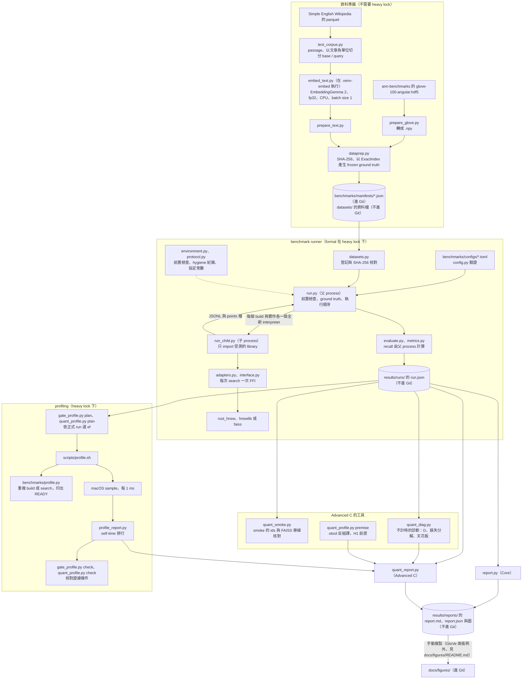
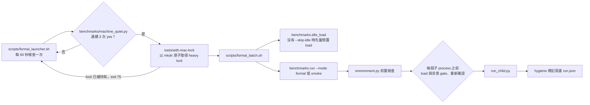

# 系統架構

本文件說明 rust-hnsw 的程式結構、量測流程與資料流。研究問題與結果見 [README](../README.md)，正式報告的轉錄見 [results.md](results.md)，
研究定義見 [SPEC.md](../SPEC.md)，每一項設計決定見 [docs/decisions/](decisions/)（繁體中文），重現步驟見 [reproduce.md](reproduce.md)。

專案分成三層：

- **Rust 實作**（`crates/hnsw`）：從零實作的 HNSW（cosine）、exact brute force、save / load，以及 Advanced C 的 SQ8 表示。沒有任何外部相依。
- **Python binding**（`python/`）：PyO3 + rust-numpy + maturin，Python module 名稱為 `rust_hnsw`。
- **benchmark harness**（`benchmarks/`、`scripts/`、`tools/`）：rust-hnsw、hnswlib、FAISS 走同一層 Python batch interface；
  包含 runner、報告、profiling、hygiene 檢查與 Mac heavy lock。

所有正式量測都在同一台 Apple M4 Pro 的 macOS 上執行，而且都是單執行緒。runner 用到 macOS 專屬的系統介面（見第 4 節），沒有在其他平台上執行過。

## 1. 資料流

- 進 Git 的只有程式、測試、文件、config、manifest（來源、checksum、切分與 frozen ground truth 的 SHA-256）與 `docs/figures/` 的圖。
  資料檔（`datasets/`）與原始輸出（`results/`）都不進 Git（`.gitignore`）。
- runner 只輸出每個量測點的原始數字（008；輸出格式見 008 §12）。從原始數字到讀值與判定，由 `report.py` 與 `quant_report.py` 依事先登記的規則處理（010、015、019 §6）。
- frozen ground truth 用來省掉大 n 的 exact search；runner 比對 train、queries 與 ground truth 檔的 SHA-256，並重算前 100 個 query，相符才使用（011 §1）。
- `docs/figures/` 的 12 張圖中，10 張與 `results/reports/` 的同名檔逐位元相同；GloVe 的 `frontier_n100000.png` 與 `scaling.png` 在本機的 GloVe 報告目錄中沒有對應檔，
  出處見 [docs/figures/README.md](figures/README.md)。對照表見 [reproduce.md §G](reproduce.md#g-報告與-readme-圖的重產)。

## 2. Rust crate 與 Python binding

### `crates/hnsw`

| 檔案 | 內容 | decision |
| --- | --- | --- |
| `src/lib.rs` | 公開 API 的 re-export；`NodeId`（`u32`，依插入順序從 0 編號）與 `Neighbor` | 001 |
| `src/distance.rs` | cosine distance（`1 − dot`）與正規化：norm 與除法以 f64 計算，存成 f32 unit vector；index 內部只用 `cosine_distance_unit` | 001 |
| `src/exact.rs` | `ExactIndex`：brute force，f64 累加 dot，以 `(distance, id)` 排序。只作 ground truth 與 correctness baseline | 001 |
| `src/batch.rs` | exact 與 HNSW 共用的批次輸入輸出：檢查 k、整批驗證並正規化（任一列不合法就整批拒絕）、結果不足 k 時補 `PADDING_ID` 與 `+inf` | 001、002、004 |
| `src/hnsw.rs` | `HnswIndex` 的 insert 與 search。演算法細節對齊 hnswlib（heuristic 選鄰居、layer 0 容量 2M、`max(ef, k)`）。所有比較以 `(distance, id)` 排序（001；hnswlib 的部分 priority queue 只比距離，兩者只在距離完全相同時可能不同，004）。表示法刻意採最直接的寫法：向量是一個連續的 `Vec<f32>`，graph 是每個節點各自的 `Vec<Vec<u32>>`，visited set 是每次搜尋新建的 `std::collections::HashSet<u32>`（內部是 hashbrown 的 `HashMap`，預設 SipHash） | 001、004 |
| `src/hnsw/persist.rs` | save / load：76-byte header（含 header CRC）→ vectors → graph → file CRC；串流讀取，配置量只隨實際讀到的資料成長 | 005 |
| `src/hnsw/quant.rs` | Advanced C：`into_quant` 把建好的 FP32 圖原樣移入 `QuantIndex`，再轉成 FP32 或 SQ8 表示；走訪函式逐行複製 Core，距離換成 `#[inline(never)]` 的 `rhnsw_kernel_fp32`、`rhnsw_kernel_sq8`；只能搜尋，不能 add，也沒有 save / load | 019 §3、§4 |
| `src/rng.rs` | SplitMix64：HNSW level 的決定性亂數。自帶實作，避免外部 crate 升級改變亂數序列 | 004 |
| `src/error.rs` | `HnswError`（非法輸入一律回傳錯誤，不默默修正）與 `PersistError` | 001、005 |
| `src/crc32.rs` | IEEE 802.3 / zlib CRC-32，供檔案格式使用 | 005 |
| `tests/` | Rust 整合測試：distance、exact、hnsw、persist（損壞與截斷）、load 的配置量、quant | 001–005、019 |

### `python/`：`rust_hnsw` module

| 名稱 | 內容 | decision |
| --- | --- | --- |
| `ExactIndex(dim)` | brute force 的 `add` 與 `search(queries, k)`；只用於 ground truth 與 correctness 檢查 | 001、002 |
| `HnswIndex(dim, m=None, ef_construction=None, seed=None)` | `add`、`search(queries, k, ef_search)`、`save`、`HnswIndex.load`。未指定的參數使用 m = 16、ef_construction = 200、seed = 100；benchmark 的 adapter 一律明確傳入（007 §5）。`efSearch` 是每次 search 的參數，不是 index 的狀態 | 004–006 |
| `QuantHnswIndex` | Advanced C。`build(data, m, ef_construction, seed, representation)` 以 Core 的 `HnswIndex::new` + `add` 建圖，再轉成 `"fp32"` 或 `"sq8"`；`build_pair` 只給診斷用（建一次圖，clone 後分別轉換）；另有 `search_stats`、`exact_search`、`memory_accounting` 等不計時的診斷方法 | 019 §4 |
| `sq8_encode(data)` | SQ8 codec，供與 FAISS 的 codes 比對（C8） | 019 §4 |
| `BUILD_INFO` | `python/build.rs` 在編譯時記錄的 profile、opt-level、debug、rustflags、`CARGO_PROFILE_*` 與 `rustc -V`。formal runner 以它確認被量測的是 release build | 008 §10、§11 |

- binding 只收 float32、C-contiguous 的 2-D array，不做隱性轉型或複製；每次 `search` 處理整批 query，計算期間釋放 GIL（002、006）。
- formal 量測一律使用 `maturin develop --release` 的預設設定（opt-level 3，沒有 `target-cpu=native`，沒有 LTO），由 `./scripts/test.sh` 編譯（008 §11）。

## 3. 量測隔離與公平性

各項規則的登記時點：

- 002、007、008（本文）與 010 的規則都在第一個 formal run（`20261009T080239Z-formal`）之前登記；014 也在第一個 formal run 之前、看到任何正式結果之前決定。
- 015（Gate 的讀法）寫於 GloVe 的 formal 1–4 完成之後、看任何效能數字或報告之前（015 照實記錄）。
- 電力條件與協定版本的修訂（016–018，2026-10-11 至 2026-10-15）在 GloVe 的正式結果之後。
- Advanced C 的部分（019 與它在 002、007、008、010 等的補記，2026-10-16 起）在 Core 的正式結果之後、任何量化結果之前。
- 下文提到這些後來的項目時，另外標明出處。

### 002：同一層 Python batch interface

- 每個實作只提供 `build(data)` 與 `search(queries, k)`（`benchmarks/interface.py` 的 `AnnIndex`）；efSearch 由 `set_ef_search` 設定（006）。
- harness 在**計時之外**呼叫一次 `prepare_vectors`：轉成 float32、C-contiguous、L2 正規化。三個實作吃同一份 unit vectors。
- 輸出格式統一（ids int64、distances 為 float32 cosine distance、升冪、不足 k 時補 `-1` / `+inf`），轉換都在 adapter 內，由 `check_search_result` 驗證。
- **每次 `search` 是一次 FFI 呼叫處理整批 query**，adapter 內沒有 per-query 的 Python 迴圈。
- **單執行緒**：Core 與 Advanced C 的 build 與 search 都是單執行緒。
- QPS 用整批呼叫的 wall time 換算；P50 / P95 以 batch size 1 逐筆呼叫**同一個介面**量測，所以三者付出相同的 Python / FFI 成本。
  latency 數字因此包含 Python / FFI 的呼叫成本；空呼叫成本另外記錄，只作參考，不從 P50 / P95 扣除。
- 已知對自己不利的 overhead：Rust 的 insert 與 query 內部會再正規化一次（對 unit vector 幾乎是 no-op，但有 O(d) 成本），保留並照實註明。

### 007：第三方 library 的實測語意

- 語意以實測為準，釘在 `tests/test_third_party_semantics.py`；版本固定為 hnswlib 0.8.0、faiss-cpu 1.15.1（`requirements-dev.txt`），升級前必須重跑並修訂 007。
- hnswlib 用 `space="ip"`（`"cosine"` 會在每次查詢時再正規化並複製）；FAISS 用 `METRIC_INNER_PRODUCT`。
- 三個 adapter 都在 build 時檢查輸入是 unit norm：Rust 的內部正規化會掩蓋錯誤輸入，不檢查會讓比較偏向自己。
- 單執行緒的設定方式：hnswlib 每次呼叫都傳 `num_threads=1`；FAISS 的 OpenMP 設定是 per-thread，所以在 build 與每次 search 開頭都呼叫 `omp_set_num_threads(1)`。
  測試以「其他 thread 消耗的 CPU time」驗證設定真的生效，並有多執行緒的正對照。
- 不模擬、不 fallback：hnswlib 結果不足 k 時整批 raise，adapter 不改成逐筆查詢；FAISS 的 `efSearch < k` 語意不同，所以 runner 強制 `ef ≥ k`。這個不對稱照實報告。
- **三者建出的 graph 不等價**（FAISS 的新點在 layer 0 最多選 2M 個鄰居、插入順序也不是 row 順序），所以同 (M, efC, ef) 的 recall 曲線與 build time 不能直接對照。
- **SIMD 與編譯旗標**（§8，必須與結果一起報告；runner 也寫進每份 run.json 的 `distance_kernels`）：
  - hnswlib 0.8.0：PyPI 只有 sdist，在本機編譯，依其 `setup.py` 為 `-O3 -march=native`（推論，不是觀察到的）。arm64 上沒有手寫 SIMD：乘法被自動向量化，加總是依序的純量 `fadd`。
  - FAISS：官方 NEON wheel（`get_compile_options()` 為 `OPTIMIZE DD ARM_NEON MAC_METAL`）。
  - rust-hnsw：release 預設、沒有 `target-cpu=native` 的純量 f32 迴圈（SIMD 屬 Optional，沒有做）。

### 008：runner 的隔離與計時協定

- **每個（build、實作）在獨立的子 process 中量測**：`python -m benchmarks.run_child <spec>`，全新的 interpreter（不用 fork），不繼承父 process 已 import 的 library。
- **只 import 受測的 library**：`config.IMPLEMENTATIONS` 為每個實作登記唯一允許 import 的 library；子 process 在記錄 baseline 之前斷言受測 library 已載入、另外兩個沒有。
- **recall 由父 process 計算**：ground truth 在第一個子 process 之前算完；子 process 不載入 ground truth，避免 tie-aware recall 的 f64 複本主導 peak RSS。
  子 process 每完成一個 ef 點就把結果 append 到 JSONL 並 flush，原始陣列另存 `points/*.npz`；結果不從 stdout 解析。
- **交錯輪換**：外層迴圈為 build、內層為實作，第 g 個 build 把實作清單輪換 g mod（實作數）位，時間漂移不會與「實作」重疊。
  單一 build 的 config 只有一種順序（013 §5 照實註明）；Advanced C 的 10 份單一 build config 以手動位移平衡成對臂的先後（019 §5，在 Core 的正式結果之後登記）。
- **warm-up 與重跑**（`benchmarks/protocol.py`，有測試釘住）：
  - library warm-up：同參數以前 16 列建 index 並 search 一次，讓 timed build 不含一次性初始化；
  - 空呼叫：n = 1 的 index，100 次 warm-up 後取 1000 個樣本，只作參考；
  - 每個 ef：整批 warm-up 1 次；QPS 重跑 5 次；latency 先以前 100 個 query warm-up，再重跑 3 次；QPS 與 latency 區段開始前 `gc.collect()`，區段期間 `gc.disable()`；
  - Recall@1 另以每個 ef 一次不計時的 k = 1 search 取得（§7：tie 時 k = 10 的第一欄不等於 k = 1 的答案）。
- **記憶體**：子 process 在 build 前後記錄 rss、`ru_maxrss` 與 phys_footprint。index memory 的主要指標是 phys_footprint 的增量（014），rss 增量為輔助；原生檔案大小不得用於跨實作的記憶體結論。
- 協定版本：008-v1 → v2（014，第一個 formal run 之前）→ v3（017）→ v4（018）→ v5（019，只用於 Advanced C）；v3 起的版本都在 GloVe 的正式結果之後登記。報告拒絕合併不同協定版本的 run。

### 010：比較規則

- 比較只在相近的 Recall@10 下進行：每個（實作、n）以所有 (M, efC, ef) 點組成 frontier，每點取跨 seed 的 median；
  對目標 0.90 / 0.95 / 0.99，在達標的點中取 QPS 最高、P50 / P95 最低、index memory 最低的點。**不內插、不外推**，沒有達標就記「未達到」。
- 有 hygiene 標記的點不進入主要讀值，另外列表；排除與否會改變讀值時兩者都列（§3）。
- seed 與 insertion order variance：保留每個 build 的原始值，報告 median 與 min–max；主要結論必須附上 variance 格點的 seed 範圍（§4）。
  FAISS 的插入順序本來就不是 row 順序，所以它的 order variance 意義不同，分開呈現。
- 比值只在兩者都達標時計算。Gate 的「有差距」另以 015 的 QPS 範圍與 seed 範圍規則判讀。

## 4. hygiene 與 lock

### 正式 run 的啟動鏈

| 元件 | 做什麼 | decision |
| --- | --- | --- |
| `tools/with-mac-lock` | 以 `mkdir /tmp/ai-portfolio-mac-heavy.lock` 原子取得跨專案的 heavy lock，寫入 owner 資訊，結束或中斷時釋放。拿不到時以 exit 75 結束；不得刪除別人的 lock | [MACHINE_POLICY.md](../MACHINE_POLICY.md)、008 §1 |
| `benchmarks/environment.py` | formal 前置檢查與 hygiene 紀錄的函式，由 `run.py` 呼叫。前置檢查：lock 由自己或祖先 process 持有、git 乾淨（含 untracked）、interpreter 是 repo 的 `.venv`、套件版本等於 pin、`BUILD_INFO` 為 opt-level 3 且沒有 debug assertions、binding 晚於 HEAD 與每個 tracked 的 Rust / binding 原始碼、資料集已登記且 SHA-256 相符、config 已 commit、AC 電源與電力條件。每個子 process 之前（load 等待之後）與最後一個子 process 之後重新確認 lock owner、HEAD、git 狀態、三個擴充模組的 SHA-256 與電力條件，不符就把 run 記為 `invalid` 並停止。只讀系統狀態，不修改系統設定，也不碰 lock | 008 §1、§2、§8–§10，014，018 |
| `benchmarks/protocol.py` | 協定常數：重跑次數、warm-up、load 門檻 4.0 與等待上限 600 秒、背景 heavy workload 的門檻、電力條件（powermode 0 或 2、Apple 原廠 70W 或 140W 變壓器）。整份寫進每份 run.json | 008、014、017、018、019 §4 |
| `benchmarks/machine_quiet.py` | 決定**開始的時機**：heavy lock 沒人持有、背景沒有瞬間 %CPU ≥ 50 的 process、1 分鐘 load < 4.0、GPU 使用率 ≤ 20%、系統記憶體 free ≥ 30%、（指定時）powermode 符合。GPU 與 RAM 兩項是專案作者 2026-10-16 要求加上的。run 是否有效仍由 runner 的協定判定 | 008 §2、014、016、019 §5 |
| `benchmarks/idle_load.py` | 第一次 formal 之前，在 heavy lock 與 formal 電力條件下量 5 分鐘預備期加 10 分鐘的 1 分鐘 load；確認門檻 4.0 是否適用（P95 + 1.0）。有其他重工作時判為 `not_idle`，不能用來確認門檻 | 008 §2 與補記、014 |
| `scripts/formal_launcher.sh` | 等 `machine_quiet` 連續 3 次成立，再以新的 session 在 heavy lock 下啟動 `formal_batch.sh`；lock 被搶先拿走時不搶占，回去繼續等。成功印出 `LAUNCHED`，等超過上限印出 `GAVE_UP` | 008 §2、014、016 |
| `scripts/formal_batch.sh` | 在同一次 lock 持有中：沒有 `--skip-idle` 時先跑 `idle_load`，結果必須是 `ok`；有 `--powermode N` 時，每份 config 之前確認 powermode 是 N；依序執行，任一 run 的 exit code 不是 0 就停。log 標記 `IDLE_START` / `IDLE_END` / `RUN_START` / `RUN_END` / `STOP` / `ALL_DONE` | 013 §5、014、016、019 §9 |

- **子 process 之前的 gate**：1 分鐘 load ≤ 4.0，而且背景沒有 heavy workload（自己、祖先與受測子 process 以外，任一 process 的瞬間 %CPU ≥ 50）。
  不成立就每 15 秒重查，最多 10 分鐘；仍不成立就中止整個 run（`aborted`），不放寬門檻。
- **formal 期間 repo 不得有任何變動**（含 untracked 檔案）：重新確認會檢查 HEAD 與 `git status`，變了就是 `invalid`（014 補記）。
- **macOS 專屬的介面**：phys_footprint（libproc 的 `proc_pid_rusage`）與 VM 統計（libSystem 的 `task_info`）、`pmset`、`sysctl`（含 Apple Silicon 的 `hw.perflevel0/1`）、
  `vm_stat`、`ioreg`、`memory_pressure`；relief 診斷呼叫 libSystem 的 `malloc_zone_pressure_relief`；profiling 用 macOS 的 `sample`，H1 前提用 Command Line Tools 的 `otool`。
  smoke 模式走同一個量測函式，所以也需要 macOS。

### hygiene 標記的意義

標記分成子 process、build、ef 點三層，報告時合併到點上（008 §9、014）。被標記的點**照常報告、不會被悄悄重跑**，但不進入主要讀值，另外列表；
排除與否會改變讀值時，兩種讀值都列（010 §3）。

| 標記 | 觸發條件 |
| --- | --- |
| `load` | 該點（或 build）結束時，1 分鐘 load 超過 4.0 |
| `background` | 子 process 期間每 15 秒讀一次所有 process 的累積 CPU 時間：同一 pid 整段平均 ≥ 50%、同一 command 合計整段平均 ≥ 100%，或同一 pid 連續 4 個區間平均 ≥ 50%（014 補記） |
| `thermal` | 子 process 前後的 `pmset -g therm` 出現等級不為 0 的 warning，或 CPU speed / scheduler limit < 100 |
| `memory` | build 期間這個 process 的累計被壓縮量 > 2% × footprint 增量 + 1 MiB（014 補記） |
| `swap` | 子 process 前後 swap 使用量增加 |
| `power` | 子 process 前或後不是 AC 電源 |
| `multithread` | build、QPS 或 latency 區段中，其他 thread 的 CPU time 超過該區段 process CPU time 的 2% 加 1 ms（007 §6） |
| `nondeterministic` | warm-up 與重跑的 ids 不一致，或逐筆與整批的 ids 不一致 |

- run 的狀態：`complete`、`incomplete`（某個子 process 失敗，照實保留、不重跑）、`aborted`、`invalid`、`error`。
  後三者整份 config 重跑，原本的 run 只能以報告的 `--excluded` 列出；因環境變化而作廢的 complete run 登記在 `report.py` 的 `VOIDED_RUNS`（016、017）。
- Advanced C 另外規定：主要讀值與 quantization frontier 判讀排除被標記的 build，每側至少 3 個未標記的 build；H1 的時間類配對只用「乾淨配對」（019 §6）。

**這些規則實際造成的影響**（照實列出）：

- Core：GloVe n = 1,183,514 的三個 build 都被標記 `background`，這一格沒有主要讀值，只有包含標記點的讀值（`results/reports/glove-100-angular/report.md`；NEXT.md）。
- Advanced C：GloVe 的 seeds 1、4、5 被標記 `background`（seed 1 在 S，seeds 4、5 在 F；seed 5 另有 `load`）。runner 的背景取樣記下的來源是 macOS 的 `duetexpertd`、`ugrep`，
  以及一個不屬於本次 run 的 `.venv/bin/python`，都是沒有取 lock 的其他工作；紀錄只證明它們不屬於本次 run，沒有記下它們屬於哪個專案（019 第三則補記）。
  結果是 GloVe 在 e\* 只剩 seeds 2、3 兩個乾淨配對（第 6 節）。seed 2 的 P（build 與 ef 64、96）與 seed 3 的 F（ef 96、128）另有 `load` 標記；
  H1 看的是 F、S 在 e\* = 304 的配對，seeds 2、3 在那裡沒有標記。文字的 5 個 C run 沒有任何標記。

## 5. 模組對照表

`benchmarks/` 的每個模組（角色取自各模組的 docstring）：

| 檔案 | 角色 | decision |
| --- | --- | --- |
| `benchmarks/__init__.py` | 套件：三套 ANN 實作共用的 batch interface、adapters 與指標 | 002 |
| `benchmarks/interface.py` | `AnnIndex` protocol、`prepare_vectors`、`check_search_result`、`IncompleteResultsError` | 002、006 |
| `benchmarks/adapters.py` | 各實作的 adapter：`RustExact`（ground truth）、`RustHnsw`、`Hnswlib`、`FaissHnsw`，以及 Advanced C 的 `RustHnswFp32g`、`RustHnswSq8`、`FaissHnswSq8`。每次 search 只做一次 FFI；build 時檢查 unit norm | 002、006、007、019 §3–§4 |
| `benchmarks/config.py` | TOML config 的解析與驗證（計時之前）；`IMPLEMENTATIONS` 登記實作與子 process 唯一允許 import 的 library；`execution_order` | 008 §3、§5，019 §4 |
| `benchmarks/datasets.py` | 資料集的登記（manifest）與載入；synthetic 資料只給 smoke，formal 一律拒絕 | 008 §1、§4，011 |
| `benchmarks/dataprep.py` | 資料準備的共用工具：manifest、檔案 checksum、frozen ground truth | 011 §1 |
| `benchmarks/prepare_glove.py` | 下載 ann-benchmarks 的 HDF5、轉成 `.npy`、frozen ground truth、寫 manifest | 011 §2 |
| `benchmarks/text_corpus.py` | 文字 corpus 的前處理與 base / query 切分：以加鹽的 SHA-256 排序文章，不依賴亂數產生器 | 011 §3.2、§3.3 |
| `benchmarks/embed_text.py` | 以 EmbeddingGemma 2 產生 768 維 embedding（固定 revision、fp32、CPU、batch size 1、逐位元重現檢查）；在 `.venv-embed` 執行 | 011 §3.4 |
| `benchmarks/prepare_text.py` | 串起文字 workload：驗證 parquet 的 SHA-256 → `text_corpus` → `embed_text` → frozen ground truth → manifest | 011 §3、012 |
| `benchmarks/protocol.py` | 協定常數，整份寫進每份 run.json；改動任何一項都要另寫 decision | 008、014、017、018、019 §4 |
| `benchmarks/environment.py` | formal 的前置檢查與 hygiene 紀錄（只讀系統狀態） | 008 §1、§2、§8–§10，014 |
| `benchmarks/run.py` | runner 的父 process：驗證、ground truth、執行順序、子 process 管理與指標計算；`DISTANCE_KERNELS` 記錄各實作的 kernel 事實 | 008 |
| `benchmarks/run_child.py` | 子 process：在全新的 interpreter 量測一個（build、實作）；最後做 relief 診斷（008-v5） | 008 §5、§6，019 §4 |
| `benchmarks/evaluate.py` | 父 process 在子 process 結束後計算的指標與資料集檢查 | 008 §4、§6、§7 |
| `benchmarks/metrics.py` | `recall_at_k`（id-based，主要）與 `tie_aware_recall_at_k`（診斷） | 003 |
| `benchmarks/report.py` | Core 報告：frontier、比值、seed / order variance、scaling、recall vs efSearch、Gate 讀值與圖；合併前的檢查（`MEASUREMENT_PATHS`、`FORMAL_CONFIGS`、`VOIDED_RUNS`） | 010、013 §5、014、015 §1、§3，016、017 |
| `benchmarks/idle_load.py` | 第一次 formal run 之前的閒置 load 基準量測 | 008 §2 與補記、014 |
| `benchmarks/machine_quiet.py` | 排程用的「機器是否閒置」判斷，由 `formal_launcher.sh` 呼叫 | 008 §2、014、016、019 §5 |
| `benchmarks/profile.py` | profiling 的工作負載：透過同一層 adapter 重複執行 build 或 search，印出 `READY`；不輸出任何 latency / QPS | 009、015 §2、019 §8 |
| `benchmarks/profile_report.py` | 解析 macOS `sample` 報告的 top of stack，整理成 self-time 排行；沒有符號的列保留，無法解析的列報錯 | 009 與補記 |
| `benchmarks/gate_profile.py` | Gate profiling 的計畫（依正式 run 選 ef）與取樣後的證據核對；`PROFILED_PATHS` | 015 §2、009 |
| `benchmarks/quant_smoke.py` | Advanced C 真實資料 correctness smoke 的核對：F / R / P 與 Core 的 ids、FAISS 的移植 | 019 §9 第 6 步 |
| `benchmarks/quant_diag.py` | Advanced C 的不計時診斷：距離評估次數 D、recall 損失的分解、天花板、結構大小 | 019 §7 |
| `benchmarks/quant_profile.py` | Advanced C 的 profiling 計畫與核對、事先固定的分類規則、H1 前提的反組譯檢查（`premise`） | 019 §2、§8 |
| `benchmarks/quant_report.py` | Advanced C 的報告：frontier、配對讀值、H1 / H2 判定表、一致性檢查 C1–C8 | 019 §6 |

其他目錄：

| 位置 | 角色 | decision |
| --- | --- | --- |
| `benchmarks/configs/` | runner 的 TOML：`smoke.toml`、`smoke-duplicates.toml`（synthetic，只驗證 runner）；`*-correctness.toml`（真實資料的 correctness smoke）；`glove-cost-probe*.toml`（成本探測）；`glove-formal-1…8`、`text-formal-1…4`（Core formal）；`quant-<glove\|text>-seed-1…5`（C formal）；`<glove\|text>-quant-smoke.toml`（C 的 smoke） | 008 §3、013、019 §5、附錄 |
| `benchmarks/manifests/` | 每個資料集的來源、checksum、切分與 frozen ground truth | 011、012 |
| `scripts/test.sh` | 全部 correctness 檢查：rustfmt、clippy `-D warnings`、`cargo test`、`maturin develop --release`、pytest（有 `.venv-embed` 時另跑模型測試） | — |
| `scripts/profile.sh` | 等 `READY` 之後以 macOS `sample` 取樣，輸出到 `results/profiles/` | 009 |
| `scripts/formal_launcher.sh`、`scripts/formal_batch.sh` | 正式 run 的等待與批次（第 4 節） | 013 §5、014、016 |
| `scripts/probe_reusable_memory.py` | 重現 macOS 上「已釋放的大型配置仍算在 rss」的量測問題 | 008 §8、014 |
| `scripts/probe_core_codegen.py` | 比對兩個 commit 中 Core 函式的機器碼（只描述） | 019 第一則補記第 5 節 |
| `tools/with-mac-lock` | Mac heavy lock | MACHINE_POLICY.md |
| `examples/quickstart.py` | API 的 Demo（synthetic 資料，數字不是研究結果） | 019 §10 |
| `tests/`、`crates/hnsw/tests/` | Python 與 Rust 測試，包括在 C 之前釘住 Core 輸出與檔案 bytes 的 golden test（`tests/test_core_golden.py`） | 各 decision |

## 6. Advanced C：R / F / S / P / Q 如何共用同一張圖

### 為什麼有 Advanced C

SPEC 的 Gate 有四個條件。依事先登記的 015，判讀如下（NEXT.md「目前狀態」的 Gate 四條件；各資料集正式報告的「Gate 讀值」一節）：

| 條件 | 判讀 |
| --- | --- |
| 1. correctness 通過 | 成立：`./scripts/test.sh` 全部通過；真實資料的 correctness 通過 |
| 2. recall 隨 efSearch 沒有系統性惡化 | 成立：兩個資料集、每個 (n, M, efC) 都沒有 |
| 3. 同 recall 下與 hnswlib 有差距 | **不成立**：GloVe 主要目標 0.95 為 `within_quantization`（0.90 為 `uncertain`、0.99 為 `within_quantization`）；文字三個目標都是 `within_quantization` |
| 4. profiler 已顯示時間花在哪 | 成立：12 次取樣都通過 `gate_profile check` |

- `within_quantization` 指「在 ef 梯子的量化解析度內無法區分」，與 vector quantization 無關，也**不**代表「很接近 hnswlib」（015 §1）。
- 進入 Advanced C 是專案作者 2026-10-16 依 SPEC 的特例（Core 已很接近 hnswlib 時，Advanced 改聚焦 vector quantization frontier）做的決定。
  這是專案作者的判斷，不是 015 的讀值，**不代表 Gate 通過**；Core 的正式結果、Gate 判讀與事先登記的比較規則都沒有修改。C 的假設、臂、判定規則與停止條件在任何量化結果之前事先登記（019，commit 4c5cbc2）。

### 五個臂

| 代號 | 實作名稱 | 怎麼建圖 | 搜尋時的表示 | seed |
| --- | --- | --- | --- | --- |
| R | `rust-hnsw` | Core 的 `HnswIndex`（錨點） | FP32，Core 的搜尋路徑 | 1 |
| F | `rust-hnsw-fp32g` | `QuantHnswIndex.build`：Core 的 `HnswIndex::new` + `add`，再 `into_quant` | FP32，複製的搜尋路徑，kernel `rhnsw_kernel_fp32` | 1–5 |
| S | `rust-hnsw-sq8` | 與 F 相同的建圖，`into_quant` 時訓練並編碼 SQ8，然後釋放 FP32 向量 | SQ8（per-dim min–max，非對稱：query 保持 FP32），同一條複製的搜尋路徑，kernel `rhnsw_kernel_sq8` | 1–5 |
| P | `faiss-hnsw` | FAISS `IndexHNSWFlat`（與 Core 相同的 adapter） | FAISS FP32 | 1–3 |
| Q | `faiss-hnsw-sq8` | 以與 P 相同的參數與步驟建 `IndexHNSWFlat`，把 graph 移植進 `IndexHNSWSQ`（QT_8bit + RS_minmax），再釋放 Flat | FAISS SQ8（NEON SIMD kernel，只作描述） | 1–3 |

兩個資料集各取 n = 100,000、(M, efC) = (16, 200)、原始插入順序；每份 formal config 只有一個 build（019 §5）。

### 「同一張圖」怎麼成立、怎麼驗證

- **R、F、S**：每個臂在自己的子 process 裡重新建圖，但都走 Core 同一段 insert 程式、同一個 seed、同一個插入順序。004 規定相同 seed 加上相同插入順序產生完全相同的 graph，
  `into_quant` 只把 nodes 與 entry point 原樣移入，不改任何鄰居。所以 R、F、S 的圖逐位元相同，差別只在搜尋時的表示與搜尋路徑。
  - 測試：F 的 `search_batch` 與 Core `HnswIndex::search_batch` 的 ids、distances 逐位元相同；`into_quant` 之後 entry point、各點 level、各層 neighbors 都與 clone 的 FP32 index 相同（019 §4）。
  - 正式 run 中的核對 **C7a**：F（seeds 1–5）與 R（seed 1）在每個共同 ef 的 ids，與 Core 正式 run 逐位元相同（`results/reports/quant-glove/report.md`、`quant-text/report.md`）。
  - 不計時的診斷（`quant_diag`）用 `build_pair` 建一次圖、clone 後分別轉成 FP32 與 SQ8，再以 ids 與 formal run 逐位元核對，把診斷綁定到 formal（019 §7）。
- **P、Q**：FAISS 單執行緒、同 seed 時是決定性的（007）。Q 的 adapter 先以與 P 相同的參數與步驟建 Flat，再把 `hnsw` 結構（levels、offsets、neighbors、entry point、max level）深複製進 `IndexHNSWSQ`。
  - **C8**：`quant_diag` 在 `del flat` 之前核對移植後的 graph 與 Flat 完全相同，並確認重建的 Q 在 e\* 的 ids 與 formal 相同。
  - **C7b**：P（seeds 1–3）的 ids 與 Core 正式 run 中的 FAISS 逐位元相同。
- 因為圖相同，**同 (seed, ef) 的配對讀值**（S 對 F、Q 對 P）只在這兩組配對上開放（010 補記、019 §6）；跨實作的比較仍只在相近 recall 下進行。
- **搜尋路徑**：F、S 用的是 Core 走訪函式的逐行複製，kernel 以 `#[inline(never)]` 拆出，讓 profiler 能把時間歸屬到 kernel。
  這個拆分的代價由 **C4**（F ÷ R 的 QPS，seed 1、e\*）量化：GloVe 0.97、文字 0.99，都在 [0.90, 1.10] 內，判為一致。F 與 S 的函式邊界相同，所以 H1、H2 不受影響。
- **機器碼的已知差異**：加入 quant 模組之後，Core 的原始碼沒有改，但 hnsw crate 的 codegen 改變了：Core 的 `search_layer` 把 visited set 的 `HashMap::insert` inline 進來。
  所以 C5（對照 Gate profiling）依構造會不一致，原因在 formal 之前就已登記；C6（C 中 R 的 QPS ÷ Core 正式 run）同時包含時間漂移與機器碼差異，只描述（019 第一則補記第 5 節）。
  C 的絕對 QPS 因此不與 Core 的表直接比較。

### 判定的狀態（只摘錄，完整的表在報告中）

來源：`results/reports/quant-glove/report.md` 與 `quant-text/report.md` 的「完整判定表」（兩份報告列出同一張表）、019 第三則補記。報告不進版控；完整判定表的轉錄見 [results.md](results.md)。

| 列 | 判定 |
| --- | --- |
| H1 前提（兩個 kernel 的加總都是依序的純量相依鏈，反組譯） | 成立 |
| H1a 文字：ρ_eval 在 [0.90, 1.10] | **成立**（5 個乾淨配對，[0.961, 1.092]） |
| H1b GloVe：ρ_eval ≥ 1.05 | **無法判定**：e\* = 304 的乾淨配對只有 seeds 2、3 兩個，規定至少 3 個 |
| H1c 維度對比 | 無法判定（理由同 H1b） |
| H1d profiler | 無法判定：GloVe seed 1 的 S 在 e\* 有 `background` 標記（這條規則只看 seed 1，與乾淨配對的數目無關） |
| **H1 整體** | **無法判定** |
| H2 GloVe、H2 文字（recall 損失來自排序，不是走訪） | 成立、成立 |
| **H2 整體** | **成立** |

- 乾淨配對不足的原因是第 4 節的背景負載干擾。依 019 §9，complete 的 run 不得重跑；是否補 seed 由專案作者決定，專案作者 2026-10-19 決定照實報告、不補 seed，C 收尾後封版。
- **C1（診斷用的 ΔM_relief 對照理論值 3·n·d − 8·d；M_relief 只是診斷，主要記憶體指標 M_014 不由 C1 判定）**：GloVe 的 F − S 判為**不一致**：只有 seed 5 偏離 4,030,488 B（≈ 3.84 MiB），超過容許值 max(5% × Δ_theory, 2 MiB) = 2 MiB（2,097,152 B）；
  其餘 seed 都在容許值內。GloVe 的 P − Q、文字的 F − S 與 P − Q 都一致。seeds 1、4、5 的配對帶有 `background` 標記；C1 只排除 `memory` / `swap` 標記的 build（019 第一則補記第 4 節），所以照列。

### SQ8 的速度與記憶體取捨

Recall@10 ≥ 0.95 的 frontier 讀值（跨 seed median，排除被標記的 build；M_014 是 phys_footprint 增量，C 的主要記憶體指標）：

| 資料集 | 臂 | ef | QPS | M_014 (MiB) | 來源 |
| --- | --- | --- | --- | --- | --- |
| 文字 | F | 48 | 2,277（5 builds） | 318.8 | `results/reports/quant-text/report.md` |
| 文字 | S | 64 | 1,769（5 builds） | 99.0 | 同上 |
| GloVe | F | 304 | 1,877（3 builds） | 105.4 | `results/reports/quant-glove/report.md` |
| GloVe | S | 384 | 2,299（4 builds） | 76.1 | 同上 |

- **事先登記的 quantization frontier 判讀**（015 的 QPS 範圍與 seed 範圍規則，套用到 S 對 F）：GloVe 0.90 / 0.95 都是 `uncertain`；文字 0.90 為 `within_quantization`、0.95 為 `uncertain`。
  Q 對 P：GloVe 都是 `uncertain`，文字都是 `within_quantization`。
  包含被標記 build 的判讀：GloVe 的 Q 對 P 在 0.90 與 0.95 都是 `within_quantization`（報告標為「不同」；P 排除被標記的 build 後只剩 2 個，少於每側 3 個）；其餘相同。兩者不同時並列，不自行擇一（015 §1）。
  - GloVe 的 F、S、P 排除被標記 build 之後讀值有變：例如 P 在 0.95 為 3,350（2 builds），包含被標記 build 時為 2,969（3 builds）；兩種讀值見 [results.md](results.md) §6.6、§6.7。
  - `uncertain`：兩者的 QPS 範圍分開，但 seed 範圍沒有分開，或未標記的 build 不足；`within_quantization`：QPS 範圍重疊，在 ef 梯子的解析度內無法區分（015 §1，019 §6）。
  - 這是事先登記的描述性判讀，不是假設（019 §6）。
- **看到結果之後的描述（不是判定）**：文字上 S 需要較大的 ef 才達到 0.95，QPS 讀值低於 F，換來的是 M_014 從 318.8 MiB 降到 99.0 MiB；
  GloVe 上 S 的 QPS 讀值較高、M_014 較低，但事先登記的判讀是 `uncertain`，H1b 也無法判定，所以不能寫成「SQ8 在 100 維上更快」。
- build time 與 peak RSS 不會下降：SQ8 先建 FP32 的圖再轉換（019 §1）。結論只適用於 Rust 的依序純量 kernel、搜尋期間的表示、n = 100,000、(16, 200)。
